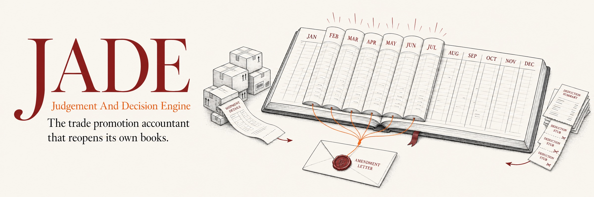

# JADE — Judgement And Decision Engine



<p align="center">
  <b>Cal Hacks 13.0</b> &nbsp;·&nbsp; <b>Hyphenate track</b> &nbsp;·&nbsp; Autonomous trade promotion accounting for General Mills
</p>

<p align="center">
  <a href="docs/getting-started.md">Getting started</a> &nbsp;·&nbsp;
  <a href="docs/architecture.md">Architecture</a> &nbsp;·&nbsp;
  <a href="docs/proof.md">Proof</a> &nbsp;·&nbsp;
  <a href="docs/api.md">API</a> &nbsp;·&nbsp;
  <a href="spec.md">Build spec</a>
</p>

## Overview

Trade spend is the second-largest line on a consumer packaged goods income statement after cost of goods.
General Mills ships cereal and granola bars to Walmart, Costco and Kroger, promises promotional support, and
accrues what it owes the moment the truck leaves. The retailer collects months later by deducting from what
it pays, often at a different rate, citing a program from two quarters ago, with backup that doesn't tie.
Someone has to decide what is owed, what is disputed, and what the accrual should have been all along.

**JADE fills two seats: the trade promotion accountant and the deduction analyst.** It accrues on shipment,
matches the deductions that arrive months later, clears what the agreement supports, disputes what it
doesn't, restates closed months when terms change, and packages the close for a person to sign. It asks a
person only when the agreement can't settle the question, and an answer, once given, is reused.

- **Every number by code.** Accruals, clearing, catch-ups and ratios are computed deterministically. The model drafts questions and phrases answers; it never does arithmetic and never approves.
- **Asks once.** A person's answer becomes a precedent, and the same situation passes silently next time.
- **Can't approve its own deal.** Segregation of duties is a capability check that throws, not a prompt.
- **Reopens its own work.** When the past changes, it restates closed months and keeps both reasonings.
- **Checkable in Excel.** Every close exports as CSVs with check rows; verifiability gates block a bad period instead of warning.

## The story


In February, Walmart and General Mills amend scan-back program TP-0214: **$3.80 a case becomes $4.20.**
The amendment is signed, filed, and never entered. Every accrual from February on is booked at the old rate,
and six months close on it, each one a little short.

In August the amendment finally reaches the books. JADE reads it into the program's terms, re-prices the
months already closed, and finds the gap on its own: **$1,391,636.52 under-accrued across six periods.** It
proposes the restatement and sends the controller a card recommending approval. When the Walmart sales lead
who negotiated TP-0214 tries to approve it himself, the request throws. The controller approves, the
catch-up posts into February through July, and nothing that was posted before is touched.

Ask it *"Why is February now different?"* and it answers both ways: what February looked like on what was
known at the time, and what it looks like now.


The ledger is bitemporal and insert-only: every row records when it was true and when the system learned
it. Correct then and correct now are both answers to the same query, run at two points in time.

## How it works


Each **Step** runs one simulated month, handling each source row on the day it arrives:

1. **Read the agreements.** Contracts and amendments are parsed into terms, each citing its clause.
2. **Accrue on shipment** at the projected redemption rate, as contra-revenue against the trade promotion liability.
3. **Match each deduction** to a program, its shipments and its claim backup, and run 12 controls mined from last year's books.
4. **Clear, dispute or ask.** A precedent settles it silently; a new situation becomes a card for the right person, with the agent's recommendation.
5. **Gate the period.** Debits equal credits, nothing over-cleared, nothing stale, every claim inside its window, or the period doesn't close.
6. **Explain the movement.** Flux commentary cites the exact journal lines, and an analytical review checks the liability against General Mills' 10-K.
7. **Sign.** A named reviewer signs one package; restatement is the only way back in.

Six layers, one agent owning one function. The full picture, with the sequence of a month and the code
map, is in [Architecture](docs/architecture.md); who may decide what is in
[People and controls](docs/people-and-controls.md).

## Proof

50 errors are planted in 24 months of books, with an answer key. JADE is scored on what it finds.

| | Seed 1337 | Seed 42 (unseen) | Seed 2024 (unseen) |
|---|---|---|---|
| Precision, month 12 | 100% | 100% | 100% |
| Recall, month 12 | 100% | 100% | 100% |

In the played year, **37 of 40 repeat situations settled by precedent** without asking; the 3 asked again
were each larger than any amount approved so far.

**What is real:** General Mills, its customers, and its FY2025 and FY2026 10-K figures from SEC EDGAR
(net sales $18.42B, Walmart 22% of it, accrued trade and coupon promotion liabilities $493M), each quoted
with its source. **What is simulated:** every transaction, generated deterministically from a fixed seed,
because transaction-level trade data is never public. Every close checks the simulated liability against
General Mills' reported ratio.

The full breakdown, and a table of what it got wrong and how each fix is tested, is in [Proof](docs/proof.md).

## Getting started

```sh
cp .env.example .env    # then set TEST_DATABASE_URL; ANTHROPIC_API_KEY is optional
make db-up && make db-scratch
uv sync
make seed               # 24 months of books, fingerprint 731ff15914136d8f
make players            # run the live year, print the scores
make api                # the API on :8000 for the UI
```

More commands, and running the frontend: [Getting started](docs/getting-started.md).

## Built with

Python · FastAPI · Postgres 16 (bitemporal, insert-only ledger) · Claude · React + Vite · pytest

## Docs

| | |
|---|---|
| [Getting started](docs/getting-started.md) | setup, `make` targets, the frontend |
| [Architecture](docs/architecture.md) | the six layers, how a month runs, code map, engine hooks |
| [People and controls](docs/people-and-controls.md) | who decides what, cards, precedents, segregation of duties |
| [Proof](docs/proof.md) | real vs simulated, scores, what it got wrong |
| [API](docs/api.md) | endpoints and live scenarios |
| [Data](DATA.md) | where every row comes from |
| [Build spec](spec.md) | the original design |

## License

See [LICENSE](LICENSE).
