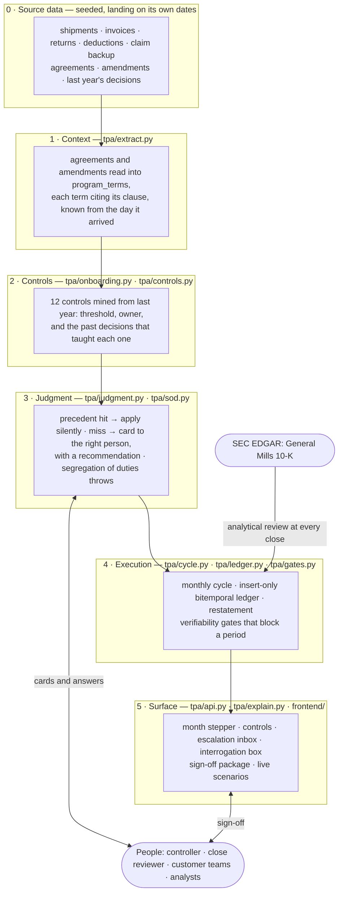
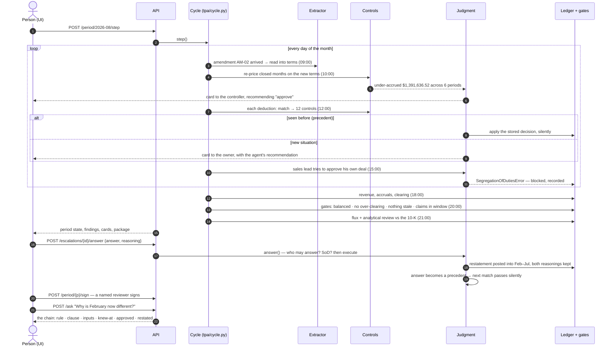

# Trade Promotion Autonomy

**Cal Hacks 13.0 · Hyphenate track.** An autonomous system for General Mills' trade promotion books.

**Seats it fills:** the trade promotion accountant and the deduction analyst. It accrues what General Mills
owes retailers when product ships, matches the deductions retailers take months later, clears what the
agreement supports, disputes what it doesn't, restates closed months when terms change, and packages the
close for a person to sign. It asks a person only when the agreement can't settle the question, and an
answer, once given, is reused.

**The moment.** In August an amendment arrives: Walmart's scan-back rate on TP-0214 went from $3.80 to
$4.20 a case back in February, and nobody entered it. Every accrual since was booked low. The system finds
the gap on its own ($1,391,636.52 across six closed months), proposes the restatement, blocks the Walmart
sales lead who negotiated the deal from approving it, posts it once the controller approves, and keeps
both answers: what February looked like on what was known then, and what it looks like now.

Build spec: [`spec.md`](spec.md). Data: [`DATA.md`](DATA.md). Rules every change follows: [`AGENTS.md`](AGENTS.md).

## Quick start

```sh
cp .env.example .env    # then set TEST_DATABASE_URL; ANTHROPIC_API_KEY is optional
make db-up              # Postgres 16 on localhost:5433
make db-scratch         # tpa_scratch, the database tests reset
uv sync
make seed               # 24 months of books, fingerprint 731ff15914136d8f
make players            # run the live year with the played humans, print the scores
make api                # the HTTP API on :8000 for the UI
make test               # 129 tests, against TEST_DATABASE_URL only
```

| Command | What it shows |
|---|---|
| `make players` | the year end to end: judgment engine, played humans, scores and "answers that stuck" |
| `make says-no` | the same, with the controller overruling the agent on Walmart's quarter-straddling claims |
| `make year` | last year's answers applied directly, no judgment engine (a baseline) |
| `make step` | one month at a time, cards left for a person (`TPA_HUMANS=inbox`) |
| `uv run python scripts/evaluate.py --as-of month-1 --as-of month-12` | precision, recall, escalation rate, autonomy |
| `uv run python scripts/export.py --period 2026-02 --as-of month-2` | February as Excel-checkable CSVs (try `--as-of month-8` too) |
| `uv run python scripts/pull_10k.py` | re-read General Mills' 10-K figures from SEC EDGAR (needs `SEC_USER_AGENT`) |

## Architecture

Six layers, one agent owning one function. **Every number is computed by deterministic code.** The model
drafts questions, plays the people in an unattended run, and phrases answers; it never computes a number,
never approves, and any reply that changes a number or record id is discarded.



## How a month runs

Each **Step** runs one simulated month. Source rows are handled on the day they arrive, in the order the
business would see them; the close runs on the last day.



## Who decides what

| Decision | Who | How it's held to account |
|---|---|---|
| Every amount: accruals, clearing, catch-ups, ratios | Deterministic code | Debits equal credits on every journal; gates block the period; CSV exports recompute in Excel |
| Clearing what the agreement supports, within the mined tolerance | The agent | The mined control and the past cases that taught it are on the entry |
| Disputing duplicates, missing proof, unsupported amounts | The agent | Holding is always allowed; disputing never writes off |
| Anything the agreement can't settle, or over a threshold | A person, on a card with the agent's recommendation | Overruling the recommendation needs a reason; the reason becomes the precedent |
| Restatements, write-offs, signing the close | The controller / close reviewer, by name | The engine alone never approves or signs; SoD throws on the negotiator and on the agent |
| Wording of cards and answers (optional) | Claude | A rewrite that changes any number or id is thrown away |

## Working with people

- **Ask at the right moment.** Each card names who it's for (source conflict → customer team, can't verify → controller, needs authority → the control's owner), the evidence, the options, and what the agent recommends and why.
- **Answers stick.** An answer is stored as a precedent on (control, specific conflict, customer) and the next match is settled without asking. A standing approval covers only up to the largest amount a person approved; a bigger case asks again, saying why. In the played year, 37 of 40 repeat situations settled silently; the 3 asked again were each larger than any amount approved so far.
- **The controller says no.** Overruling the recommendation requires reasoning that isn't just the option's label. The precedent records what it overruled, and later cases follow the person, not the agent (`make says-no`; ask the interrogation box "What if the controller had said no?").
- **Busy approvers.** A card that has sat through a close unanswered for more than 10 days goes up to the controller, saying who didn't answer and that the close is waiting.
- **Work handed over half done.** A colleague's handoff is re-checked, never trusted: finished if every control passes, handed back with the reason if not, refused if the proposed program's terms don't cover the claim.
- **Segregation of duties.** `can_approve` throws when the approver negotiated the program, when no program can be traced (unverifiable), or when the approver is the agent.

## What is real and what is simulated

| | Source |
|---|---|
| **Real** | General Mills (CIK 0000040704) and its customers Walmart, Costco and Kroger. From the FY2026 10-K (filed 2026-07-01): net sales $18.42B, North America Retail $10.57B, Walmart 22% of net sales and 31% of North America Retail, accrued trade and coupon promotion liabilities $493M, and the trade promotion accounting policy. FY2025: $19.49B and $470M. Each figure is quoted with its source in `tpa/seed/calibration.py`. The accounting rules (ASC 606, ASC 326) in `.claude/rules/`. |
| **Simulated (seeded)** | Every transaction: 24 months of shipments, invoices, returns, deductions, claim backup and disputes; the agreements and amendments as documents; last year's human decisions; the 50 planted errors. Generated deterministically from seed 1337 (`tpa/seed/`). Transaction-level trade data is never public, on either side of the trade. |
| **Simulated (people)** | The humans who answer cards in an unattended run: the played humans (`tpa/players.py`) take the agent's recommendation, or Claude plays the role and must pick one of the card's options. In the UI a real person answers instead (`TPA_HUMANS=inbox`). |
| **Not simulated** | Everything the system does with that data. The agreements are read from their text (`tpa/extract.py`); the generator's structured terms are only the extractor's answer key, compared in `tests/test_extract.py`. Controls are mined from last year's decisions, not configured. Every posting goes through one write path into an insert-only ledger. |
| **How it fits** | Every close compares the simulated liability with General Mills' real ratio (`tpa/review.py`): 2.16%–3.37% of net sales all year, against 2.41% and 2.68% reported. One brand family at Walmart is $348M a year, about 11% of General Mills' North America Retail sales to Walmart. The $1.39M catch-up is 4.8% of TP-0214's annual accrual and 0.008% of net sales: material to the program, immaterial to the company. |

## Proof it works

50 planted errors with an answer key (`data/answer_key.json`), scored by `tpa/evaluate.py`. Findings on
rows a judge injects live are scored apart.

| | Seed 1337 | Seed 42 (unseen) | Seed 2024 (unseen) |
|---|---|---|---|
| Precision, month 12 | 100% | 100% | 100% |
| Recall, month 12 | 100% | 100% | 100% |

The unseen seeds use the same generator and error types, placed differently: evidence the system isn't
fitted to one answer key, not that it would catch a kind of error never planted. On seed 1337 the played
year also reports escalation rate 40% (month 1) and 50% (month 12), autonomy 67% and 56%, and 37 of 40
repeat situations settled by precedent. The escalation rate stays level because new kinds of situations
keep arriving (a learned control in September, a new ambiguous clause); repeats don't escalate.

### What it got wrong

Found by testing on seeds we didn't develop on and with injected scenarios. Each fix has a test.

| Found by | What it did | Why it was wrong | Fix |
|---|---|---|---|
| Seed 42 | Flagged Kroger's January display claim as over-claimed | It split December's straddling display event by days, eating January's accrual; a per-event fee is accrued whole in one month | Clear on the accrual's basis: an event belongs to the month it starts in (`accrual.claim_share`); the window gate dates events the same way |
| Injected early claim | Raised a 98% redemption-drift alarm | One claim stream had arrived; Walmart sends two | Judge sell-through only once every stream the customer sent last year covers the month |
| Injected late backup | Nothing: the claim stayed disputed | No one re-checked a claim held for missing backup when the backup came | Re-check on arrival; withdraw our own dispute and clear, or raise what the backup shows |
| Injected self-approval | Let a sales lead approve an unmatched claim | No program meant no negotiator to compare with | Unverifiable is blocked |
| Injected handoff | Cleared a claim with no backup | The colleague proposed the wrong program, whose terms don't cover the claim, so every check passed vacuously | A handoff the agreement can't verify goes back |
| Costco instalments | Released an accrual while its claim sat unapplied | Rule 03: never clear one side and leave the other | Apply the unmatched instalment first, release only the residual |
| Final audit | Terms were loaded from the generator's answer key, not read | The agent was handed the contracts' terms | `tpa/extract.py` reads every agreement and amendment; one generated agreement (TP-0232) had lost its rate to a planted ambiguous clause and was corrected to state it |

## Frontend

React + Vite in `frontend/` (designed in Figma): period overview, journal entries, verification gates,
restatement comparison, flux review, the escalation inbox and the interrogation box.

```sh
make api                        # the backend on :8000; Vite proxies /api to it
cd frontend && bun install
VITE_API_MODE=http bun run dev  # against the real API
bun run dev                     # or replay captured responses (VITE_MOCK_SCENARIO=inbox | moment)
bun test && bun run build && bun run lint
```

The mock replays responses captured from the real API (`uv run python scripts/frontend_fixtures.py`
regenerates them); it computes nothing. For the live demo, run in `http` mode.

## Live scenarios

Hyphenate may ask for a scenario of their own. `POST /api/scenario` adds source rows to the month the clock
is on, and the engine meets them on the next step exactly like seeded data (`step: true` runs it at once).

| Kind | Example | What the engine does |
|---|---|---|
| `deduction` | a scan-back claim with no backup, or at a rate the program doesn't say | dispute by precedent, or a "which is the source of truth?" card |
| `duplicate` | a claim taken twice | caught, citing the original |
| `backup` | scan data arriving for a held claim | re-checks; withdraws its own dispute and clears |
| `return` | cases coming back after the month was accrued | re-makes the accrual net of them |
| `amendment` | a rate change effective months ago, as a document | reads it, re-prices the closed months, asks the controller |
| `approval_attempt` | the sales lead approving his own program's claim | blocked by segregation of duties |
| `handoff` | a colleague's half-finished match | re-checked, then finished or handed back with the reason |

`GET /api/scenario/examples` gives ready-made ones against the books as they stand.

## API

`make api`, or `uv run uvicorn tpa.api:app --reload`. Amounts are decimal strings, never floats.

| Endpoint | |
|---|---|
| `GET /api/clock` | where the simulation is |
| `GET /api/period/{p}?as_of=` | state per customer, postings, findings, gates, flux, analytical review, as the books stood then |
| `POST /api/period/{p}/step` | run the month the clock points at |
| `POST /api/period/{p}/sign` | `{customer_id, signed_by}` a named reviewer signs a clean period |
| `GET /api/period/{p}/package?as_of=` | the sign-off package |
| `GET /api/period/{p}/export/{ledger,trial_balance,reconciliation,gates}.csv` | the package with Excel check rows |
| `GET /api/controls` | the mined controls with their precedents and fired counts |
| `GET /api/precedents/{history,live}/{id}` | a precedent cell's click-through |
| `GET /api/escalations?open=true` | the inbox: question, options, recommendation, evidence |
| `POST /api/escalations/{id}/answer` | `{answer, answered_by?, reasoning?}` writes the precedent |
| `GET /api/explain/{entry_id}` | the evidence chain for a ledger line |
| `POST /api/ask` | `{question}` the interrogation box |
| `GET /api/metrics?as_of=` | precision, recall, escalation rate, autonomy, answers that stuck |
| `GET/POST /api/scenario`, `GET /api/scenario/examples` | live scenarios |

`TPA_HUMANS` chooses who answers a step's cards: `inbox` (a person, default), `players`, or `autopilot`.

## Code map

| Module | Role |
|---|---|
| `db/schema.sql` | the DDL; triggers make the ledger insert-only, journals balance and signed periods lock |
| `tpa/extract.py` | layer 1: agreements and amendments into `program_terms`, each term citing its clause; Claude as an optional second reader |
| `tpa/onboarding.py` | replays last year, mines thresholds, owners and precedents into `controls`; derives priors |
| `tpa/controls.py` | one check per control, shared by the replay and the live cycle |
| `tpa/judgment.py` | precedent match, escalation routing, recommendations, `answer()`, follow-ups |
| `tpa/sod.py` | segregation of duties, `can_approve` |
| `tpa/players.py`, `tpa/autopilot.py` | played humans for unattended runs; last year's answers as a baseline |
| `tpa/cycle.py` | the monthly engine and the period state machine; late backup, handoffs |
| `tpa/execute.py` | every posting a decision can lead to |
| `tpa/restate.py` | restatement: catch-ups into closed months, withdrawing our own superseded disputes |
| `tpa/ledger.py` | `post_journal`, the only write path; its docstring is the posting contract |
| `tpa/asof.py` | the bitemporal reads: `balances_as_of`, `entries_as_of`, `terms_as_of`, `entry_history` |
| `tpa/gates.py` | the verifiability gates and `sign_period` |
| `tpa/review.py` | the close's analytical review against the 10-K |
| `tpa/flux.py`, `tpa/package.py`, `tpa/export.py` | flux commentary, the sign-off package, CSV export |
| `tpa/explain.py` | the interrogation chain and `ask()` |
| `tpa/scenario.py` | live scenario injection |
| `tpa/evaluate.py` | scoring against the answer key |
| `tpa/policy.py` | every threshold that isn't mined, labelled as company policy, never GAAP |
| `tpa/model.py` | the only doorway to Claude; off unless `TPA_USE_MODEL=1` and `ANTHROPIC_API_KEY` |
| `tpa/seed/` | the deterministic generator (`fiction.py` frozen, `plant.py` the errors), `calibration.py` the 10-K figures |

## Engine hooks

`tpa.cycle.Hooks` is where judgment and people plug in. Alone, the engine decides only what a mined control
allows the agent, and never approves or signs.

| Hook | Called | Default |
|---|---|---|
| `judge(cur, finding, at)` | as each finding is raised, and at close for any still open | mechanical controls (duplicates, no proof, late returns) auto-resolve; the rest stay open |
| `on_event(cur, event, at)` | on a scripted human action's date | ignored |
| `approve(cur, restatement, at)` | when a restatement is proposed | none: waits for a person |
| `sign(cur, period, customer_id, at)` | for each clean customer-period | none: stops at REVIEWED |
| `follow_up(cur, period, at)` | at the close, before sign-off | none |

`judgment.hooks()` wires the judgment engine with cards left for people; `players.hooks()` adds the played
humans. Finding `evidence` always carries `summary`, `control` and the ids involved.
