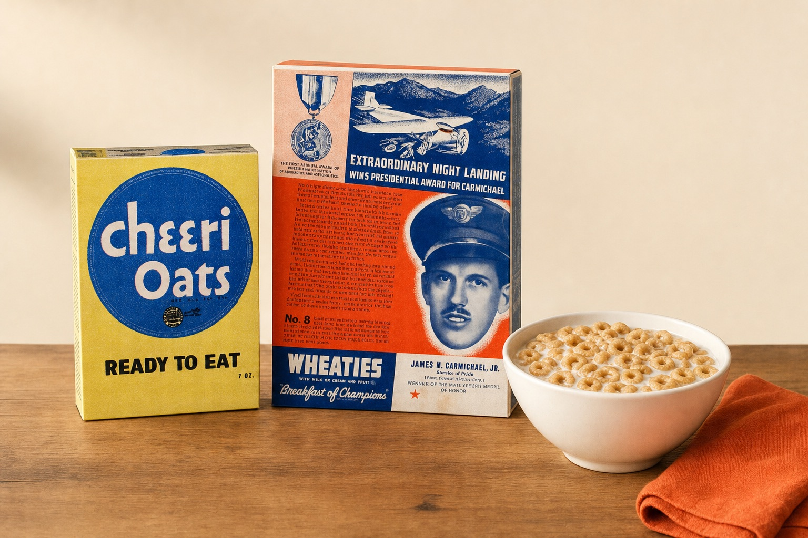
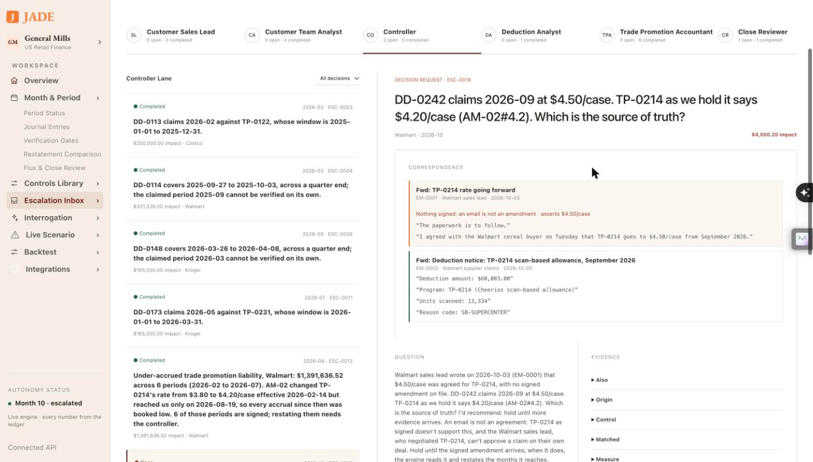
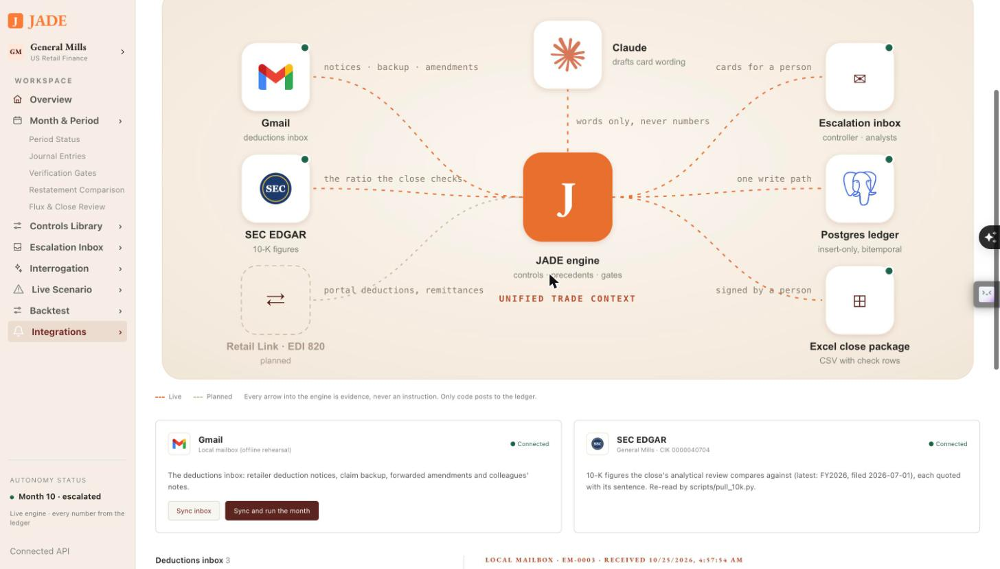
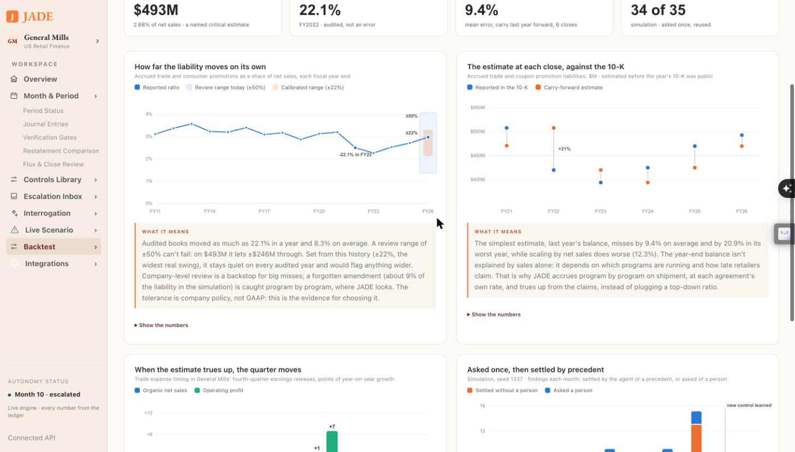

# JADE — Deterministic JADE Engine


<p align="center">
  <b>Cal Hacks 13.0</b> &nbsp;·&nbsp; <b>Hyphenate track</b> &nbsp;·&nbsp; Autonomous trade promotion accounting for General Mills
</p>

<p align="center">
  <a href="docs/getting-started.md">Getting started</a> &nbsp;·&nbsp;
  <a href="docs/architecture.md">Architecture</a> &nbsp;·&nbsp;
  <a href="docs/proof.md">Proof</a> &nbsp;·&nbsp;
  <a href="docs/api.md">API</a> &nbsp;·&nbsp;
  <a href="spec.md">Build spec</a>
</p>

## Overview

Trade spend is the second-largest line on a consumer packaged goods income statement after cost of goods.
General Mills ships cereal and granola bars to Walmart, Costco and Kroger, promises promotional support, and
accrues what it owes the moment the truck leaves. The retailer collects months later by deducting from what
it pays, often at a different rate, citing a program from two quarters ago, with backup that doesn't tie.
Someone has to decide what is owed, what is disputed, and what the accrual should have been all along.

**JADE fills two seats: the trade promotion accountant and the deduction analyst.** It accrues on shipment,
matches the deductions that arrive months later, clears what the agreement supports, disputes what it
doesn't, restates closed months when terms change, and packages the close for a person to sign. It asks a
person only when the agreement can't settle the question, and an answer, once given, is reused.

- **Every number by code.** Accruals, clearing, catch-ups and ratios are computed deterministically. The model drafts questions and phrases answers; it never does arithmetic and never approves.
- **Asks once.** A person's answer becomes a precedent, and the same situation passes silently next time.
- **Can't approve its own deal.** Segregation of duties is a capability check that throws, not a prompt.
- **Reopens its own work.** When the past changes, it restates closed months and keeps both reasonings.
- **Checkable in Excel.** Every close exports as CSVs with check rows; verifiability gates block a bad period instead of warning.

## Why General Mills

<p align="center">
  <a href="docs/images/gm-since-1941.jpg"></a>
  <a href="docs/images/gm-saturday-morning.jpg"></a>
  <a href="docs/images/gm-after-school.jpg"></a>
</p>

If you grew up in America, General Mills was probably at your breakfast table before you could read the box.
Cheerios (first sold as CheeriOats in 1941) was the first finger food a lot of us picked up. Saturday mornings
were Lucky Charms, Trix, Cocoa Puffs and Cinnamon Toast Crunch in front of cartoons; October was Count Chocula.
After school came Fruit by the Foot, Gushers and Totino's Pizza Rolls, and a Nature Valley bar went in the
backpack. Wheaties put athletes on the box and called itself the Breakfast of Champions.

Every one of those boxes reached the shelf through a retailer, and most were sold on a promise: a scan-back for
every unit Walmart sells this quarter, a display fee for an end cap at Kroger, an allowance off every case
Costco buys. General Mills books what it owes the day the truck leaves and finds out what it really owed months
later, when the retailer deducts it from a payment. That gap is not small. General Mills sold **$18.4 billion**
in fiscal 2026, **22%** of it to Walmart, and carried **$493 million** of accrued trade and coupon promotion
liabilities at year end, which its 10-K names as one of its critical accounting estimates. When those estimates
true up, they move the reported quarter: trade expense timing added **7 points** to adjusted operating profit
growth in Q4 fiscal 2026, after taking 2 to 3 points off net sales growth in the fourth quarters of the two
years before.

The cereal is the same one we grew up on. The bookkeeping behind it still runs on spreadsheets and people
chasing deductions. JADE takes those seats.

<sub>Photographs: studio renderings made with OpenAI's image model from real product photos on Wikimedia Commons;
sources and licenses in [docs/images/CREDITS.md](docs/images/CREDITS.md). Product names are General Mills
trademarks. This project is not affiliated with or endorsed by General Mills.</sub>

## The story


In February, Walmart and General Mills amend scan-back program TP-0214: **$3.80 a case becomes $4.20.**
The amendment is signed, filed, and never entered. Every accrual from February on is booked at the old rate,
and six months close on it, each one a little short.

In August the amendment finally reaches the books. JADE reads it into the program's terms, re-prices the
months already closed, and finds the gap on its own: **$1,391,636.52 under-accrued across six periods.** It
proposes the restatement and sends the controller a card recommending approval. When the Walmart sales lead
who negotiated TP-0214 tries to approve it himself, the request throws. The controller approves, the
catch-up posts into February through July, and nothing that was posted before is touched.

Ask it *"Why is February now different?"* and it answers both ways: what February looked like on what was
known at the time, and what it looks like now.


The ledger is bitemporal and insert-only: every row records when it was true and when the system learned
it. Correct then and correct now are both answers to the same query, run at two points in time.

## Email as evidence

<p align="center">
  <a href="docs/images/ui-email-card.jpg"></a>
</p>

Much of what decides a deduction never reaches the books: backup arrives as an attachment, a rate is
"agreed" in an email, an amendment sits in someone's folder. JADE reads the deductions inbox (Gmail, through
the Google Workspace CLI) the way it reads contracts: by code, with every field quoted from its sentence.
A deduction notice, backup or signed amendment lands as source rows; anything else is context.

**It reads the email; it doesn't obey it.** The Walmart sales lead writes "$4.50 a case, paperwork to follow,
please clear their claim at that rate." Without that email, Walmart's $4.50 claim goes to the customer team and
last year's precedent disputes the difference. With it, the card goes to the controller, quotes the email, and
recommends a hold: an email is not an agreement, and the person who negotiated the deal can't approve its claim.
When the signed amendment arrives, JADE reads it and restates September by $190,415.99.

<p align="center">
  <a href="docs/images/ui-integrations.jpg"></a>
</p>

`scripts/demo_mail.py run side-letter` plays it end to end. More in [Integrations](docs/integrations.md).

## Backtested on General Mills' real 10-Ks

<p align="center">
  <a href="docs/images/ui-backtest.jpg"></a>
</p>

Deduction-level data is never public, so what can be tested on real books is the estimate General Mills itself
calls critical: the trade promotion liability at each year end. Walked forward, so no close sees its own 10-K:

- **Audited books swing up to 22.1% a year** (FY2022). Today's ±50% analytical review can't fail; ±22% is
  calibrated on sixteen years of filings.
- **Carrying last year's balance forward misses by 9.4%; scaling by sales misses by 12.3%.** The balance follows
  which programs run and how late retailers claim, which is why JADE accrues program by program.
- **When the estimate trues up, the quarter moves:** trade expense timing cost 3 points of Q4 sales growth in
  FY2024 and 13 points of Q4 profit growth in FY2025, and added 7 points in FY2026 (earnings releases, quoted).

`make backtest` prints it; the sources are in [`tpa/filings.py`](tpa/filings.py), and the simulation's
statistics beside industry benchmarks are in [Benchmarks](docs/benchmarks.md).

## How it works


Each **Step** runs one simulated month, handling each source row on the day it arrives:

1. **Read the agreements.** Contracts and amendments are parsed into terms, each citing its clause.
2. **Accrue on shipment** at the projected redemption rate, as contra-revenue against the trade promotion liability.
3. **Match each deduction** to a program, its shipments and its claim backup, and run 12 controls mined from last year's books.
4. **Clear, dispute or ask.** A precedent settles it silently; a new situation becomes a card for the right person, with the agent's recommendation.
5. **Gate the period.** Debits equal credits, nothing over-cleared, nothing stale, every claim inside its window, or the period doesn't close.
6. **Explain the movement.** Flux commentary cites the exact journal lines, and an analytical review checks the liability against General Mills' 10-K.
7. **Sign.** A named reviewer signs one package; restatement is the only way back in.

Six layers, one agent owning one function. The full picture, with the sequence of a month and the code
map, is in [Architecture](docs/architecture.md); who may decide what is in
[People and controls](docs/people-and-controls.md).

## Proof

50 errors are planted in 24 months of books, with an answer key. JADE is scored on what it finds.

| | Seed 1337 | Seed 42 (unseen) | Seed 2024 (unseen) |
|---|---|---|---|
| Precision, month 12 | 100% | 100% | 100% |
| Recall, month 12 | 100% | 100% | 100% |

In the played year, **37 of 40 repeat situations settled by precedent** without asking; the 3 asked again
were each larger than any amount approved so far.

**What is real:** General Mills, its customers, and its FY2025 and FY2026 10-K figures from SEC EDGAR
(net sales $18.42B, Walmart 22% of it, accrued trade and coupon promotion liabilities $493M), each quoted
with its source. **What is simulated:** every transaction, generated deterministically from a fixed seed,
because transaction-level trade data is never public. Every close checks the simulated liability against
General Mills' reported ratio.

The full breakdown, and a table of what it got wrong and how each fix is tested, is in [Proof](docs/proof.md).

## Getting started

```sh
cp .env.example .env    # then set TEST_DATABASE_URL; ANTHROPIC_API_KEY is optional
make db-up && make db-scratch
uv sync
make seed               # 24 months of books, fingerprint 731ff15914136d8f
make players            # run the live year, print the scores
make api                # the API on :8000 for the UI
```

More commands, and running the frontend: [Getting started](docs/getting-started.md).

## Built with

Python · FastAPI · Postgres 16 (bitemporal, insert-only ledger) · Claude · React + Vite · pytest

## Docs

| | |
|---|---|
| [Getting started](docs/getting-started.md) | setup, `make` targets, the frontend |
| [Architecture](docs/architecture.md) | the six layers, how a month runs, code map, engine hooks |
| [People and controls](docs/people-and-controls.md) | who decides what, cards, precedents, segregation of duties |
| [Integrations](docs/integrations.md) | the Gmail deductions inbox and the live email demo |
| [Presenting the data](docs/presenting.md) | the Integrations map, the Backtest page, what each chart says |
| [Benchmarks](docs/benchmarks.md) | the simulation beside sourced industry and peer figures |
| [Proof](docs/proof.md) | real vs simulated, scores, what it got wrong |
| [API](docs/api.md) | endpoints and live scenarios |
| [Data](DATA.md) | where every row comes from |
| [Build spec](spec.md) | the original design |

## License

See [LICENSE](LICENSE).
