# Plan: JADE demo, transcript and close exports

Explain the problem in General Mills' own numbers, walk the real UI with a word-for-word script, and end on what a controller takes away: a flux PDF, an Excel workbook that checks itself, and a QuickBooks journal import.

Metadata

created
:   2026-10-25T05:16:10Z

modified
:   2026-10-25T05:16:10Z, 2026-10-25T06:05:00Z

commits
:   7b8e2c3, 41b6a2e

agent name
:   Claude Opus 5.5 (claude-opus-5-5), Claude Opus 5.5 (claude-opus-5-5)

session id
:   session\_01MHcQGypB3cWA8m1upqfQi7, session\_01MHcQGypB3cWA8m1upqfQi7

back refs
:   specs/part-b-cl-merge-readiness.html, docs/presenting.md, docs/integrations.md, docs/benchmarks.md, spec.md

forward refs
:   none yet

One signed close, three things a controller can hand on: the flux report, the workbook, the journal import.

## Purpose

The product works; the pitch has to make a finance judge feel the problem in the first thirty seconds and leave with something they could use on Monday. This plan does three things:

1. **Explains the problem** with sourced numbers, not adjectives.
2. **Scripts the demo** beat by beat on the real UI (screenshots below are from the running app), so any teammate can give it.
3. **Builds the ending**: the close package leaves JADE as a **flux PDF report**, an **Excel workbook** with live check formulas, and a **QuickBooks journal-entry import**, each on an export menu with its logo.

## Problem

**Trade promotion is the second-largest line on a food company's income statement after the cost of goods, and the most estimated.** General Mills promises Walmart, Costco and Kroger money for selling its cereal: a scan-back on every unit sold, a fee for an end-cap, an allowance off every case. It books what it owes the day the truck leaves, as a reduction of revenue (ASC 606). The retailer collects months later by deducting from a payment, often at a different rate, citing a program from two quarters ago, with backup that doesn't tie. Two people (the trade promotion accountant and the deduction analyst) decide what was owed, what to dispute, and what the accrual should have been all along.

**$18.4B**General Mills net sales, FY2026 (10-K)

**22%**of it to Walmart (10-K)

**$493M**accrued trade and coupon promotions, a named critical accounting estimate (10-K)

**~20%**of CPG gross sales goes to trade (Strategy&/PwC)

**−13 / +7 pts**Q4 operating profit growth moved by trade timing, FY2025 / FY2026 (earnings releases)

**~$97**to process one deduction by hand (CRF benchmark)

The failure that matters is not a bad claim; it is a *good document nobody entered*. In the simulation, Walmart and General Mills sign an amendment in February (TP-0214, $3.80 → $4.20 a case). It is filed and forgotten; six months close short. When it surfaces, someone must re-price closed months, explain the catch-up, and stop the sales lead who negotiated it from approving it. Real books show the same mechanism in public: General Mills told investors that trade expense timing cost 3 points of Q4 sales growth in FY2024 and added 7 points of Q4 profit growth in FY2026.

The accrual is booked at shipment; the evidence that settles it arrives months later, by a different route.

## Solution

**JADE, the Deterministic JADE Engine**, takes both seats. It accrues on shipment, matches each deduction to its program, clears what the agreement supports, disputes what it doesn't, restates closed months when terms change, and packages the close for a person to sign. Every number is computed by code into an insert-only ledger; a model only drafts sentences. It asks a person only when the agreement can't settle the question, and reuses the answer.

The demo ends where a controller's month ends: the signed close leaves the system in the formats finance already uses.

**Flux report (PDF)**Each material account's movement, explained by the journal lines that drove it; the analytical review against the 10-K; restatements then and now; who decided what. Ready to attach to the close binder.

**Excel workbook (.xlsx)**Ledger, trial balance, reconciliation, gates and flux on separate sheets, with live `SUM` totals and `CHECK` cells that must read 0. The existing CSV check rows, as one file.

**QuickBooks journal import**The period's summarized entries in QuickBooks Online's journal-entry import layout (and an IIF file for Desktop), accounts mapped to the company's chart. JADE stays the subledger; QuickBooks gets the posting.

Evidence in, one write path, a person signs, the package goes out.

## Usage flow: Walmart's October close

**Title:** *JADE: the trade promotion close, by agreement.*

| Who | Role at a CPG manufacturer ($1B+ in retail sales) | What they do in JADE |
| --- | --- | --- |
| **User** | Trade promotion accountant; deductions analyst (revenue accounting, US retail) | Work the "Waiting on you" queue; read the evidence; decide with a reason |
| **Approver** | Controller; close reviewer | Approve catch-ups and exceptions; sign off each customer's period |
| **Buyer** | Corporate controller / CAO | Owns the critical estimate ($493M at General Mills) and the close calendar |
| **Pitch audience** | Hyphenate judges: finance-automation builders | Want deterministic posting, human checkpoints, and proof on real data |

### The close, and where each step happens

| Close step (trade promotions) | JADE screen | Who |
| --- | --- | --- |
| 0. Contract set-up: terms read from agreements; controls mined from last year's decisions | Setup | Once, at onboarding |
| 1. Revenue and accrual at shipment: variable consideration accrued as contra-revenue (ASC 606) | Close → Journal Entries | JADE, automatically |
| 2. Deduction intake: short-pays and claim backup parsed from email or remittance | Gmail → Integrations | JADE, automatically |
| 3. Matching and clearing: each deduction matched to its program; supported claims cleared, unsupported ones disputed | Home (count settled) | JADE, automatically |
| 4. Exceptions: what the agreement can't settle goes to the person who owns it | Home → Decisions | Analyst, controller |
| 5. Change in estimate: a late amendment trues up months already closed | Decisions; Close → Restatement Comparison | Controller |
| 6. Reconciliation and review: verifiability checks, flux analysis, analytical review against the 10-K | Close → Period Status, Flux | Close reviewer |
| 7. Sign-off and the close binder | Close → Sign off; Close report (PDF) | Close reviewer |

**How to read the steps:** Click is a button to press on stage; highlighted words are what to land in the voice-over; *Ledger* is the entry behind the screen, for the judge who asks. Run it from the demo state (Phase 1: January to September played, the three emails landed, October run). Times are cumulative.

0:00

**The problem** · Home, no click.

General Mills carries $493 million of trade promotion accruals, a critical accounting estimate in its 10-K. Retailers settle them as deductions, short-paying invoices months later, often at a rate nobody booked. When the estimate trues up, the quarter moves: 13 points of Q4 operating profit growth in fiscal 2025. JADE closes these books by the agreement; you only see the calls the agreement can't make.

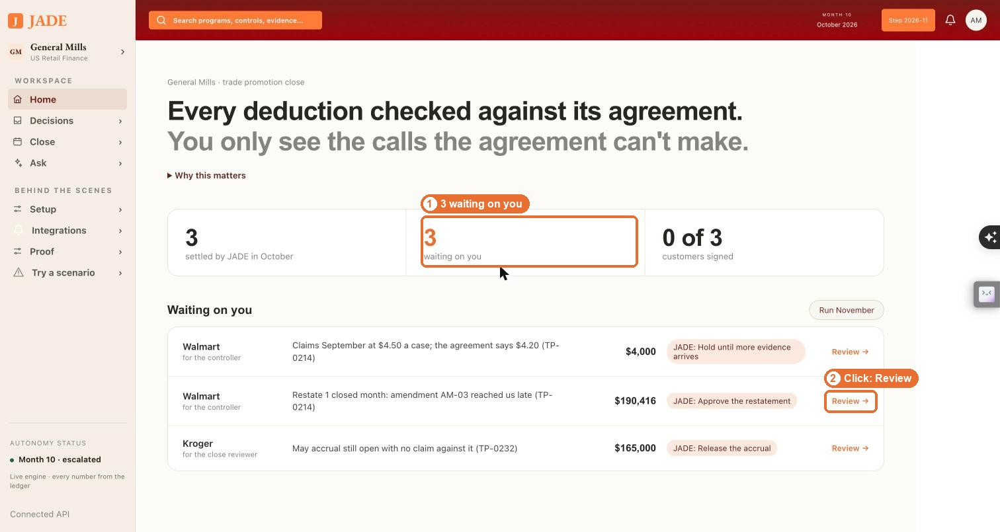

0:25

**0 · Contract set-up** · Setup → Read the agreements

Before go-live, JADE read every trade agreement into terms. Each term cites the clause it came from. TP-0214, Walmart's Cheerios scan-back, now reads $4.50 a case, from amendment AM-03. A contract that doesn't state a required term is refused, not guessed.

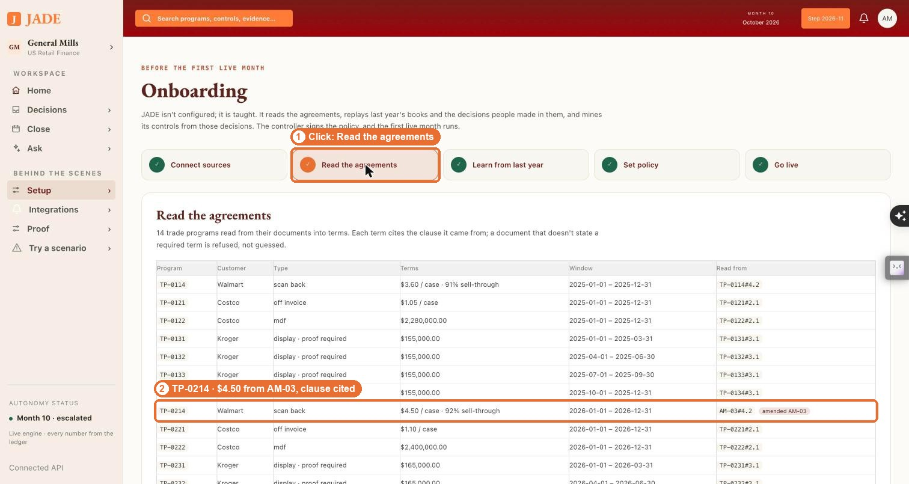

0:45

**2 · Deduction intake** · show the mailbox (live Gmail, or the demo mailbox), then Integrations → the Deduction notice row

Walmart's supplier claims team sends a deduction notice: $60,003 taken against TP-0214, September, $4.50 a case on 13,334 units. It lands in the deductions inbox. JADE parses it by code. Every field keeps the line it was read from, and the notice becomes a deduction and its claim backup in the subledger. Nobody keyed it.

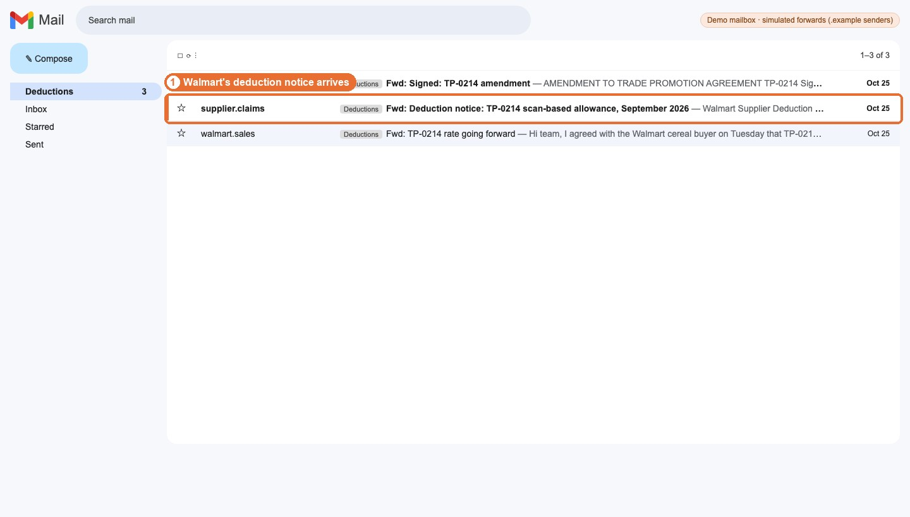
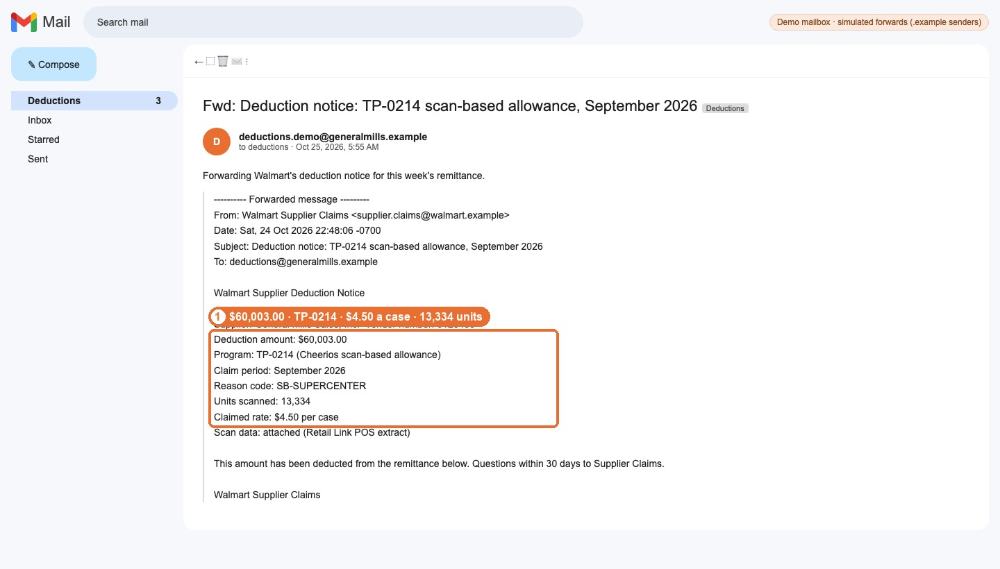
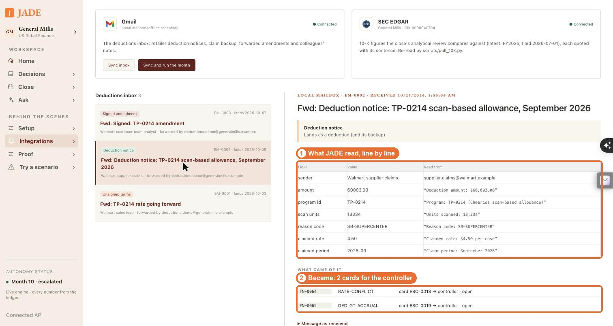

*Ledger:* Dr 1250 Deductions pending resolution / Cr 1200 Accounts receivable, $60,003.00 (JE-1361): the short-pay, held until matched.

1:15

**3–4 · Matching and exceptions** · Home → Review on the restatement row

This month JADE matched and cleared the routine deductions on its own. Three items need a person, each with JADE's recommendation. The biggest is Walmart's: the signed amendment raised TP-0214 to $4.50 from September, after September was already closed.

1:30

**5 · Segregation of duties** · Answer as someone else → Walmart sales lead → Approve the restatement

The sales lead who negotiated the deal tries to approve the catch-up himself. Refused. It's a capability check in code, not a policy reminder: the controller owns this card, and the person who negotiated the deal can never approve its money.

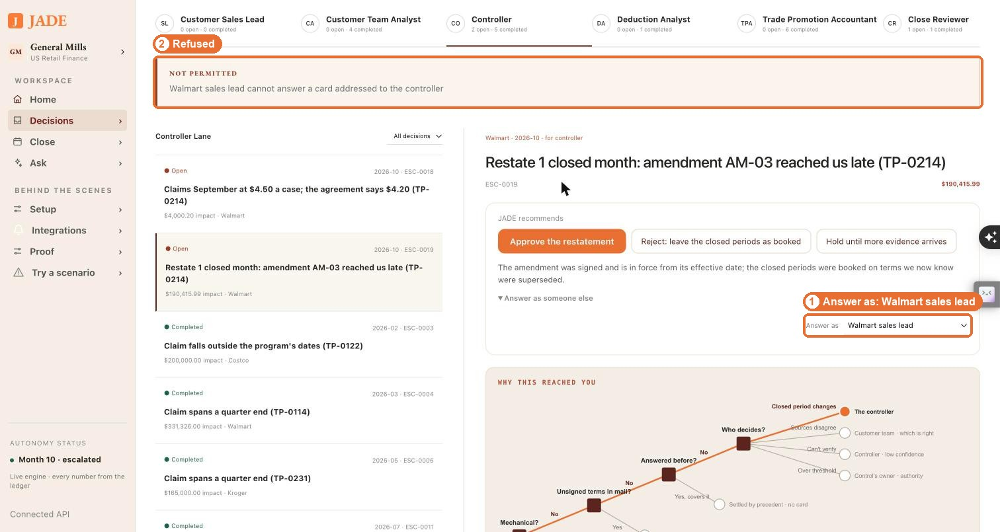

1:50

**5 · Change in estimate** · back to the controller · Approve the restatement

The controller approves a $190,415.99 catch-up: September's accrual was booked at $4.20 and the signed rate is $4.50. The tree shows why it reached her: a closed period changes, so it's the controller's call. The original September entry stays as booked; the true-up posts beside it, so what we knew then and what we know now are both on the record. The approval becomes precedent PR-0018.

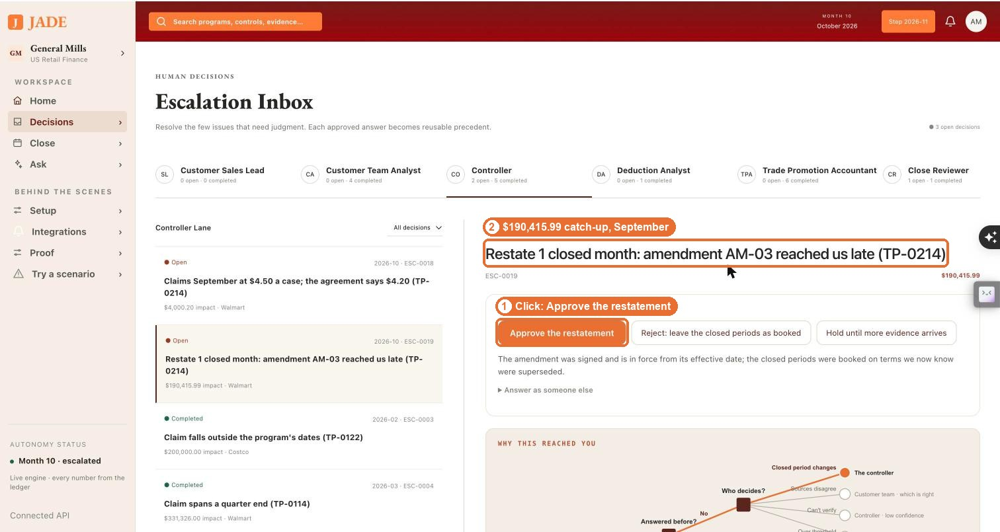
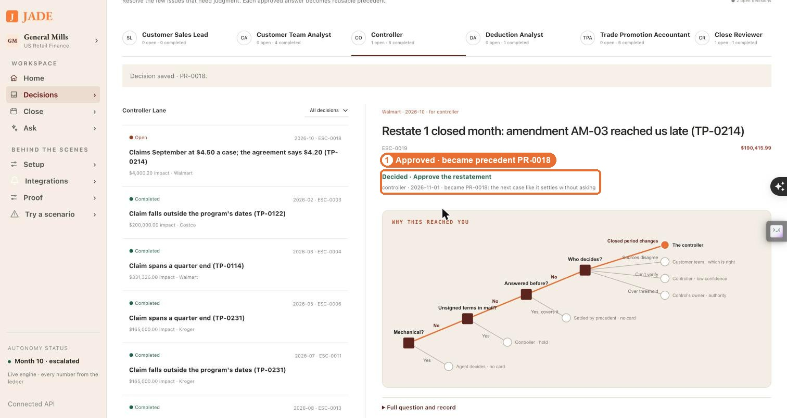

*Ledger:* Dr 4100 Trade promotion expense (contra-revenue) / Cr 2300 Accrued trade promotion liability, $190,415.99, posted to September, decided at the October close (JE-1396).

2:15

**4 · Exception with evidence** · open the $4.50 claim card · Customer's claimed rate → type the reason → Decide with my reason

Walmart's claim at $4.50 arrived before the paperwork, and the sales lead's email said "paperwork to follow". An email is not an amendment, so JADE recommended a hold. Now the signed amendment is on file, so the controller overrides with a reason: AM-03 supports $4.50 from September; clear at the claimed rate. That reason becomes the precedent for the next claim like it.

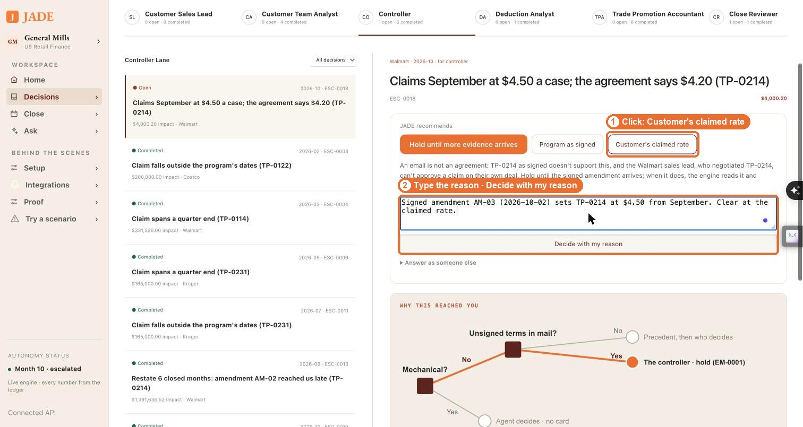

*Ledger:* Dr 2300 Accrued trade promotion liability / Cr 1250 Deductions pending resolution, $60,003.00 (JE-1397): the claim settled against September's accrual, so AR and the liability clear together.

2:40

**6 · Reconciliation** · Review the Kroger row · Release the accrual

Kroger's May display accrual has had no claim for five months, past its claim lag. Last year's analysts released accruals like it four times; JADE recommends the same, and the close reviewer agrees.

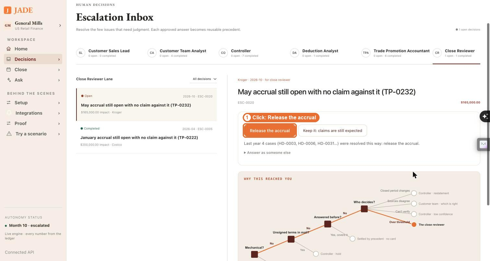

*Ledger:* Dr 2300 Accrued trade promotion liability / Cr 4100 Trade promotion expense, $165,000.00 (JE-1398): the release reverses contra-revenue in November, the open period.

2:55

**7 · Sign-off** · Close → Sign off Walmart, Sign off Costco, then Sign off Kroger

Sign-off re-runs five verifiability checks: journals balance, reversals mirror, no stale accruals, claims inside their windows, nothing cleared beyond what was accrued. Walmart and Costco sign. Kroger is blocked: the release posted to November, so October still carries a stale accrual. A check that fails blocks the close. It doesn't warn.

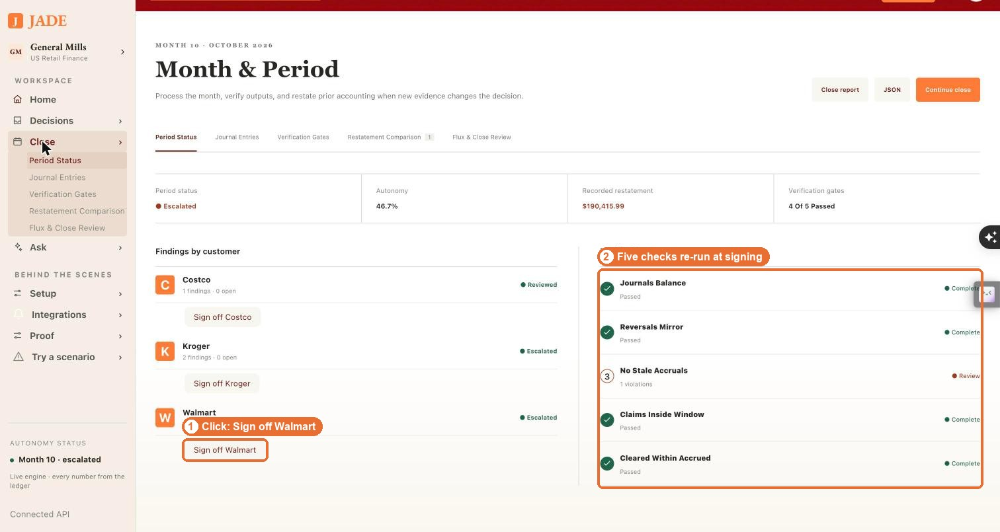
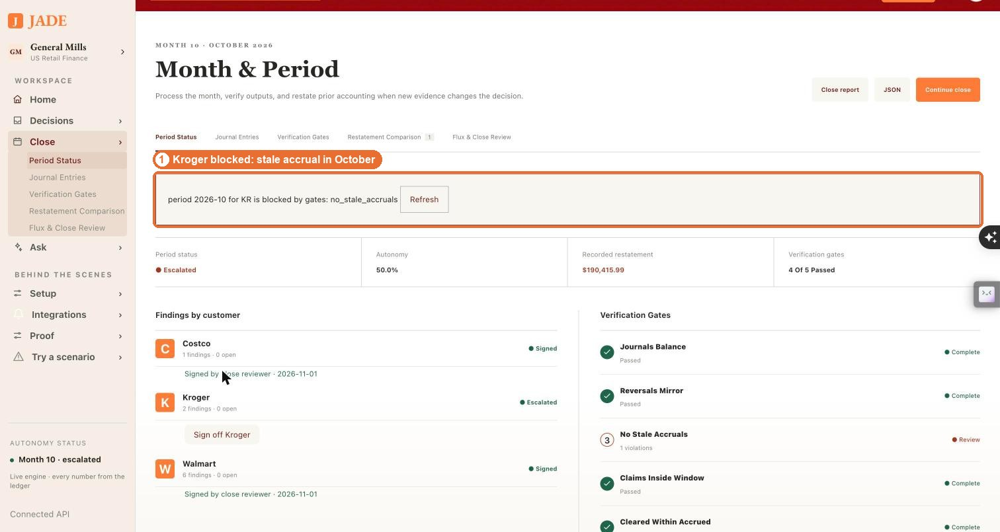

3:15

**7 · Close binder** · Close report (opens the report; print to PDF)

The close leaves as a report: flux analysis with the journal lines behind every number, the analytical review against General Mills' 10-K (3.39% of net sales against 2.68% reported, within range), each decision with who made it and its precedent, the reconciliation per program, and the sign-offs. Deterministic where money moves, a person where judgment is needed, and every number traceable to the line that made it.

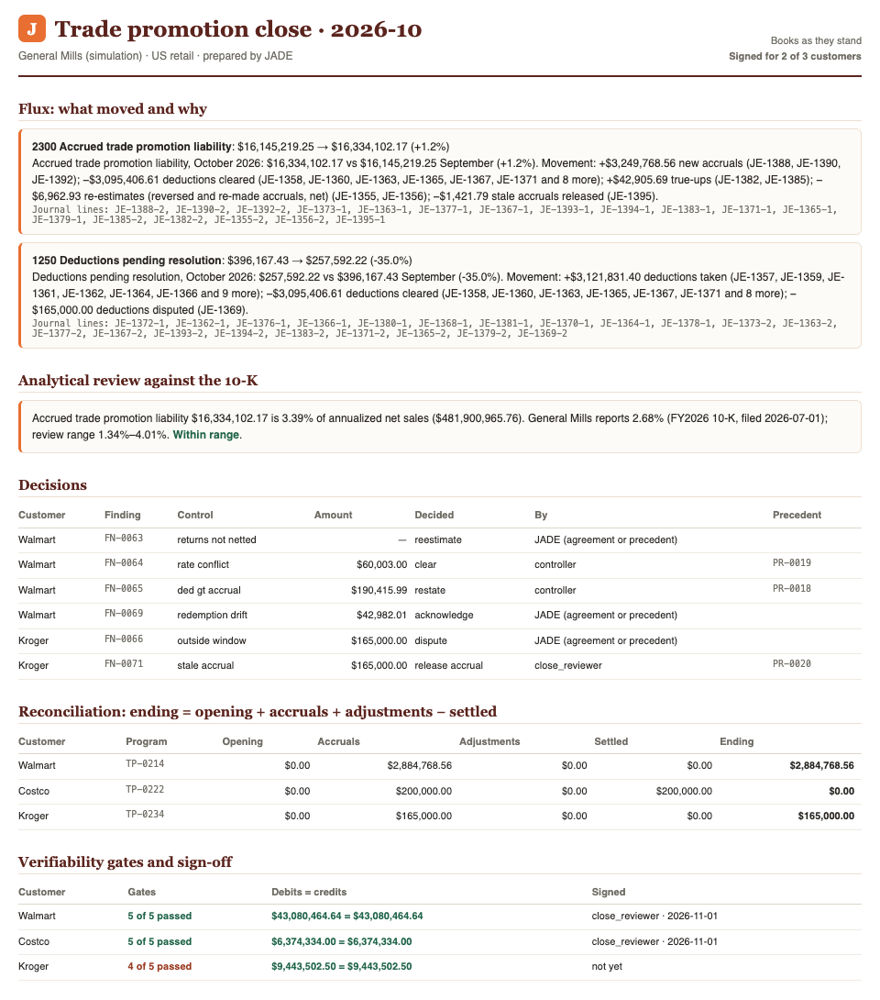

3:35

**How we test it** · Proof

Before any of this touches General Mills' books, seven checks have to pass. It catches 42 of 42 planted errors, on data it was tuned on and two sets it never saw. Three full runs of the year produce identical books; agent benchmarks call that pass^k, and most agents fail it. Run over 4,996 real emails, it acted on none. Given 102 real commercial contracts it couldn't read, it refused every one rather than guess. Then it goes live the way you'd ship any control: shadow first, then 25, 50 and 100 percent of deduction volume, each step gated on real decisions.

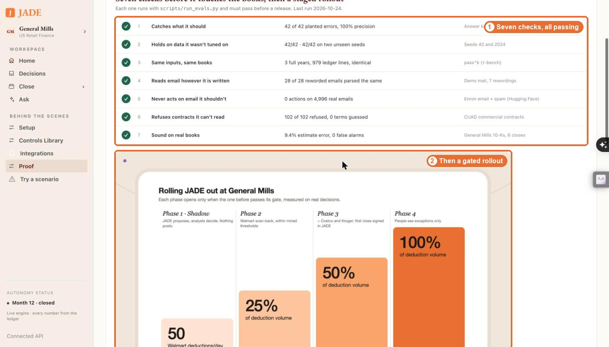
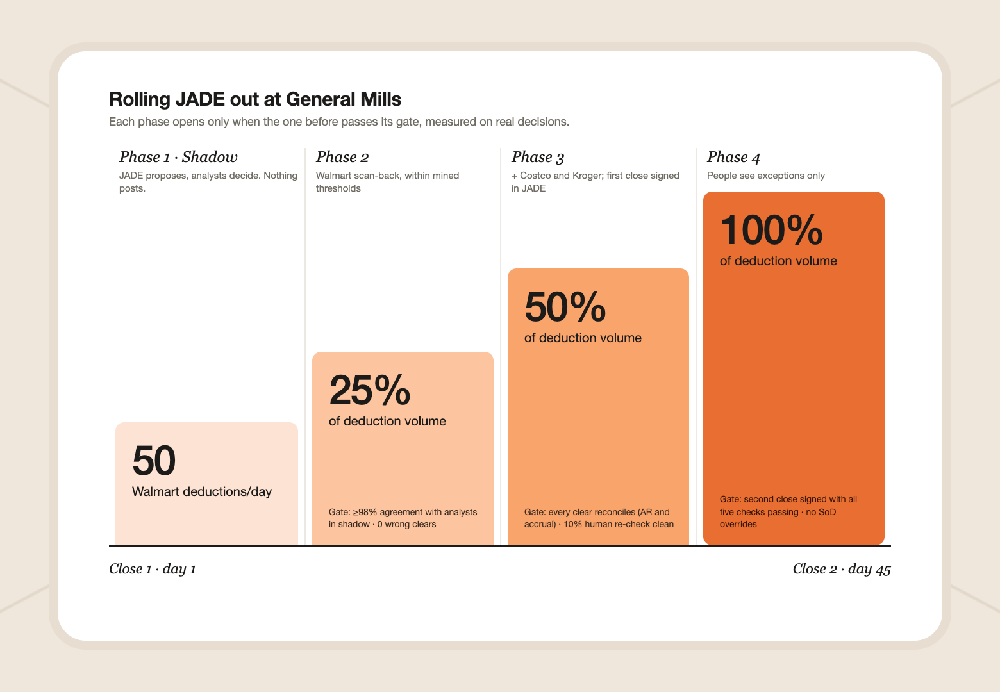

**Reset between runs:** rebuild the demo state (Phase 1). The PDF used here is [jade-close-2026-10.pdf](jade-demo-and-close-exports/jade-close-2026-10.pdf), from `scripts/close_report.py 2026-10`. The mailbox images come from `scripts/gmail_preview.py`, rendered from the scenario's own .eml files and labelled as a demo mailbox; with Gmail connected (`gws auth login -s gmail`), show the real inbox instead.

## Relevant Files

### Existing Files

- existing `tpa/package.py` — the sign-off package (postings, balances, findings with answers, gates as of, flux, analytical review, reconciliation). Every export reads it; nothing recomputes.
- existing `tpa/export.py` — today's CSVs with TOTAL/CHECK formula rows and formula-injection escaping; the Excel and QuickBooks writers reuse its row builders and `parse_as_of`.
- existing `tpa/flux.py` — flux narratives templated from journal-line sums; the PDF prints them with their driver entry ids.
- existing `tpa/review.py` — the analytical review against the latest 10-K; a boxed section of the PDF.
- existing `tpa/api.py` — `GET /api/period/{p}/export/{file}`; new files are added to the same route.
- existing `tpa/constants.py` — `Account` codes the QuickBooks mapping keys on (4100 is contra-revenue, never expense).
- existing `frontend/src/PeriodPage.tsx` — the "Export close package" button becomes the export menu.
- existing `frontend/src/api/{types,client,mock}.ts` — `exportUrl` and `ExportFile` gain the new formats; mock mode serves captured files.
- existing `frontend/public/brand/` — logos and CREDITS.md; QuickBooks joins them.
- existing `scripts/demo.sh`, `scripts/demo_mail.py`, `scripts/step.py` — the demo state is built from these.
- existing `docs/presenting.md`, `README.md` — where the transcript and the export story land.

### New Files

- new `scripts/demo_preview.sh` — one command to the demo state: seed, play January–September, land the side letter, claim and amendment by email, run October, start API and UI.
- new `tpa/report_pdf.py` — the flux and close report as a PDF (reportlab), from the package.
- new `tpa/export_xlsx.py` — the close workbook (openpyxl): one sheet per CSV plus Flux and Read me, live formulas, CHECK cells formatted pass/fail.
- new `tpa/export_quickbooks.py` — summarized journal entries as a QuickBooks Online import CSV and a QuickBooks Desktop IIF file.
- new `config/quickbooks_accounts.csv` — JADE account → QuickBooks account name and type; the company edits this, not the code.
- new `tests/test_exports.py` — the three formats tie to the package to the cent; CHECK formulas evaluate to 0; QuickBooks entries balance per journal.
- new `frontend/src/ExportMenu.tsx`, `ExportMenu.css` — the menu with logos: PDF, Excel, QuickBooks, CSV.
- new `frontend/public/brand/quickbooks.svg`, `sheet.svg`, `pdf.svg` — QuickBooks from Simple Icons (CC0); neutral marks for the sheet and PDF (Microsoft and Adobe marks are not used).
- new `docs/demo-transcript.md` — the transcript above, as plain text for rehearsal.

## Implementation Phases

**IMPORTANT:** Execute every phase and task step by step, in order, top to bottom.

Status markers: `[]` idle · `[wip]` in progress · `[x]` complete · `[f]` failed. All start as `[]`; the Build Plan workflow updates them as it works.

### `[]` Phase 1: One command to the demo state

The transcript assumes October with three emails landed and two cards open for the controller. Today that takes five commands typed in order; a demo needs one, and it must never touch the demo database by accident.

#### 1. `scripts/demo_preview.sh`

- `[]` Take the target database from `DEMO_DATABASE_URL` (default `TEST_DATABASE_URL`); refuse to run against `DATABASE_URL` unless `--yes-reset-demo` is passed.
- `[]` Run `scripts/step.py --reset --through month-9 --players`, then `demo_mail.py run side-letter --no-step` and `demo_mail.py run amendment` with `JADE_MAIL_BACKEND=local` and a fresh `JADE_MAIL_DIR`.
- `[]` Start `uvicorn tpa.api:app --port 8011` with `TPA_HUMANS=inbox` and Vite in http mode on 5183; print the URL and the stop command.
- `[]` `--gmail` switches the mail step to the Gmail backend (needs `gws auth login -s gmail`); otherwise local, so the rehearsal never depends on the network.

#### 2. Testing Strategy

Run the script against the scratch database and check the state the transcript names, through the API.

- `[]` `scripts/demo_preview.sh && curl -sf localhost:8011/api/clock` — the clock reads 2026-11 (October has run).
- `[]` `curl -sf localhost:8011/api/escalations | jq '[.[] | select(.to_role=="controller")] | length'` — 2 open controller cards (ESC-0018 hold, ESC-0019 restatement).
- `[]` `DATABASE_URL=… scripts/demo_preview.sh` without the flag — refuses and exits non-zero.

🔁 **Do not exit this phase until every box above is checked.** If any command fails, fix the cause and re-run — loop until all pass.

### `[]` Phase 2: The flux report as a PDF

The document a controller attaches to the close binder. It prints what the package already holds; it computes nothing.

Page one: what moved and why. Page two: what was decided, by whom, and what it proves.

#### 1. Content, in this order

- `[]` Header: JADE mark, "Close package · General Mills (simulation) · {period}", as-of time, period state, signed by and when (or "unsigned").
- `[]` Flux: per account over materiality, opening → closing, change %, the narrative, and its driver journal ids in a small mono line.
- `[]` Analytical review box: liability / annualized net sales, the 10-K expectation and range, inside or outside, and the 10-K citation.
- `[]` Restatements: then and now per period (original accrual, catch-up, amended rate, journal ids).
- `[]` Decisions: each finding with its card, answer, who answered, precedent id; segregation-of-duties refusals listed as refusals.
- `[]` Reconciliation identity per program and the five gates, pass/fail. Footer on every page: "Every amount is a sum of named journal lines. Prepared by JADE; approved by {signer}."

#### 2. Build

- `[]` `uv add reportlab`; `tpa/report_pdf.py` with `render(pkg: dict) -> bytes`, using Platypus tables, the parchment/oxblood/orange palette, Decimal formatted with `f"{x:,.2f}"` (never floats).
- `[]` Route: `GET /api/period/{p}/export/flux_report.pdf?as_of=` with `application/pdf` and a dated filename.

```
def render(pkg: dict) -> bytes:
    doc = SimpleDocTemplate(buf, pagesize=letter, title=f"JADE close {pkg['period']}")
    story = [header(pkg), *flux_tables(pkg["flux"]), review_box(pkg.get("analytical_review")),
             *restatements(pkg), decisions(pkg), reconciliation(pkg), gates(pkg)]
    doc.build(story, onFirstPage=footer, onLaterPages=footer)
    return buf.getvalue()
```

#### 3. Testing Strategy

pytest against a played October; text extracted from the PDF must carry the package's numbers exactly.

- `[]` `uv run pytest tests/test_exports.py -k pdf` — the PDF opens, has the period, every flux amount and driver id, and the restatement $190,415.99.
- `[]` `curl -sf localhost:8011/api/period/2026-10/export/flux_report.pdf -o /tmp/flux.pdf && file /tmp/flux.pdf` — "PDF document".
- `[]` An unsigned period prints "unsigned" in the header and the footer; a period with no flux prints "No account moved past materiality".

🔁 **Do not exit this phase until every box above is checked.** If any command fails, fix the cause and re-run — loop until all pass.

### `[]` Phase 3: The Excel workbook

The four CSVs as one workbook a reviewer opens and trusts: totals and checks are live formulas Excel recomputes, beside the computed values.

#### 1. Build

- `[]` `uv add openpyxl`; `tpa/export_xlsx.py` with sheets Read me, Flux, Ledger, Trial balance, Reconciliation, Gates.
- `[]` Reuse `tpa/export.py`'s row builders; write amounts as numbers with `#,##0.00`, ids and memos as text (formula injection stays escaped).
- `[]` TOTAL rows as `=SUM()`; CHECK cells (`=debits−credits`, `=ending−(opening+accruals+adjustments−settled)`) with conditional formatting green at 0, red otherwise.
- `[]` Freeze the header row, autosize columns, a header band with the JADE mark and the period; route `export/close_package.xlsx`.

#### 2. Testing Strategy

Tie every sheet to the package, and evaluate the CHECK formulas without Excel.

- `[]` `uv run pytest tests/test_exports.py -k xlsx` — each sheet's row count and totals equal the package; every CHECK cell's formula, evaluated from the sheet's own values, is 0.
- `[]` A memo starting with `=` is stored as text, not a formula.
- `[]` Open in Excel and Numbers once by hand; CHECK cells are green.

🔁 **Do not exit this phase until every box above is checked.** If any command fails, fix the cause and re-run — loop until all pass.

### `[]` Phase 4: The QuickBooks journal import

JADE is the trade promotion subledger; the general ledger receives one summarized entry per journal type and customer for the period. The company imports the file in QuickBooks; nothing posts without a person.

Many subledger lines in, a few balanced journals out, each citing the JADE journal ids it summarizes.

#### 1. Account mapping

- `[]` `config/quickbooks_accounts.csv`: `jade_account, qb_account_name, qb_account_type`. Defaults: 1200 → Accounts Receivable (A/R); 1250 → Deductions Pending (Other Current Asset); 1260 → Disputed Deductions (Other Current Asset); 2300 → Accrued Trade Promotions (Other Current Liability); 4000 → Sales (Income); 4100 → Trade Promotion Allowances (Income, contra); 6900 → Deduction Write-offs (Expense).
- `[]` Refuse to export if any posted account has no mapping, naming the account. 4100 must map to an income-type account (rule 1: contra-revenue, never expense); refuse otherwise.

#### 2. Files

- `[]` `quickbooks_online.csv`: one row per line with Journal No., Journal Date, Account, Debits, Credits, Description, Name. Journal No. `JADE-{period}-{entry_type}-{customer}`; Description lists the JADE journal ids; Name is the customer on every A/R line (QuickBooks requires it).
- `[]` `quickbooks_desktop.iif`: TRNS/SPL/ENDTRNS blocks, GENERAL JOURNAL type, the same journals.
- `[]` Routes `export/quickbooks_online.csv` and `export/quickbooks_desktop.iif`; only for a SIGNED period (409 otherwise: an unsigned close doesn't go to the general ledger).

#### 3. Testing Strategy

Balance and tie-out, then one real import into a QuickBooks Online sandbox company before the demo.

- `[]` `uv run pytest tests/test_exports.py -k quickbooks` — each journal's debits equal credits; the sum per account equals the trial balance movement for the period.
- `[]` An unmapped account and a 4100 mapped to Expense are both refused with the account named.
- `[]` `curl -s -o /dev/null -w "%{http_code}" localhost:8011/api/period/2026-10/export/quickbooks_online.csv` — 409 while October is unsigned, 200 after signing.
- `[]` Import the CSV into a QuickBooks Online sandbox (Settings → Import data → Journal entries); the journals appear balanced. Screenshot it for the deck.

🔁 **Do not exit this phase until every box above is checked.** If any command fails, fix the cause and re-run — loop until all pass.

### `[]` Phase 5: The export menu, with logos

The last click of the demo. The "Export close package" button becomes a menu in the style of the Integrations tiles: a logo, a name, one line on what the file is.

#### 1. Build

- `[]` `ExportMenu.tsx`: Flux report (PDF), Close workbook (Excel), QuickBooks Online, QuickBooks Desktop (IIF), CSVs (the existing four). Each item is a link to `client.exportUrl(period, file, asOf)`.
- `[]` QuickBooks items disabled with the reason ("Sign the period first") until the period is SIGNED; the reason shows on hover and for screen readers.
- `[]` Logos in `frontend/public/brand/`: `quickbooks.svg` (Simple Icons, CC0, #2CA01C); neutral `sheet.svg` (green grid) and `pdf.svg` (oxblood page); credits updated. The menu also appears on Flux & Close Review.
- `[]` Mock mode: capture October's three files into `frontend/public/fixtures/` (a fixture script, like the others) and serve them, so the demo works offline.

#### 2. Testing Strategy

- `[]` `cd frontend && bun run build && bun test` — types, the menu's disabled state, and URLs per format.
- `[]` In the browser, each item downloads a file whose name carries the period; screenshot the open menu for the README.

🔁 **Do not exit this phase until every box above is checked.** If any command fails, fix the cause and re-run — loop until all pass.

### `[]` Phase 6: Rehearse and ship the pitch

The transcript only works if it has been said out loud against the real UI, on time.

#### 1. Tasks

- `[]` Copy the transcript to `docs/demo-transcript.md`; link it from `docs/presenting.md` and the README.
- `[]` Rehearse twice from `demo_preview.sh`; trim any beat over its time. Record one clean run as the backup video.
- `[]` Gmail live only if the `--gmail` run has worked twice in a row; otherwise local mailbox, said plainly.
- `[]` Add the export menu and a page of the PDF to the README's close section.

#### 2. Testing Strategy

- `[]` `make test` — green before every commit (AGENTS.md).
- `[]` A full timed run from a cold start lands under 3:45.

🔁 **Do not exit this phase until every box above is checked.** If any command fails, fix the cause and re-run — loop until all pass.

## Validation Commands

Execute these commands to validate the entire plan is complete:

- `[]` `make test` — the whole suite, including `tests/test_exports.py`.
- `[]` `cd frontend && bun run build && bun test` — the UI builds and its tests pass.
- `[]` `scripts/demo_preview.sh` — reaches the transcript's state in one command.
- `[]` `for f in flux_report.pdf close_package.xlsx quickbooks_online.csv; do curl -sf -o /tmp/$f localhost:8011/api/period/2026-10/export/$f; done` — all three download once October is signed.
- `[]` The QuickBooks Online sandbox import succeeds and balances.

🔁 **The plan is not complete until every box is checked and every command passes. If for some reason a step is not possible to complete, mark it with [f] and move on if possible.**

## Notes

### Why import files, not a live QuickBooks connection

A live push needs an Intuit developer app, OAuth, and a sandbox company, and it moves money-shaped data into someone's books without a person looking. An import file is what controllers already use to move a subledger into QuickBooks: reviewable, reversible before posting, and real. The logo on the menu says where the file goes; the file format is what makes the claim true. A live connection is future work behind the same mapping file.

### Accounting guardrails the exports keep

- Trade promotion stays contra-revenue in every format (rule 1); the QuickBooks mapping refuses an expense account for 4100.
- Exports are read-only views of the package; the ledger's one write path is untouched. Restatements appear as their own lines, never netted into originals.
- Only a signed period goes to the general ledger file. The PDF and workbook can be produced unsigned for review, and say so on every page.
- Every number in the PDF and workbook is the package's Decimal, formatted, never re-derived or passed through a float.

### Dependencies

`uv add reportlab openpyxl`. Both are pure Python wheels; no system libraries (WeasyPrint was rejected for needing Pango).

### Risks

| Risk | Mitigation |
| --- | --- |
| QuickBooks Online's journal import columns differ from what is assumed here | Phase 4's sandbox import before the demo; adjust the column names in one place in `export_quickbooks.py`. |
| Live Gmail or network fails on stage | Local mailbox by default; mock mode serves captured exports. |
| A judge reads "General Mills" as an endorsement | Every export header says "General Mills (simulation)"; the README states the project is not affiliated. |
| Brand marks | Only Simple Icons (CC0) marks used nominatively; no Microsoft or Adobe logos; credits in `frontend/public/brand/CREDITS.md`. |

### Sources for the problem numbers

- General Mills FY2026 10-K (net sales, Walmart share, $493M critical estimate) — cited in `tpa/seed/calibration.py`.
- Trade expense timing, Q4 FY2024–FY2026 earnings releases — quoted in `tpa/filings.py`.
- Trade spend ~20% of gross sales (Strategy&/PwC 2017); ~$97 per deduction (CRF 2012, via Clarkston) — `docs/benchmark-sources.md`.

The demo in four beats: the problem, the reopened books, the email, the close that leaves.

## Amendments

2026-10-25 — The transcript becomes a usage flow along the close, with clicks, screenshots and a real report

Replaced the demo transcript with a usage flow for Walmart's October close: target users and buyer, the close steps mapped to screens, and each step with the buttons to click, an annotated screenshot of the real UI (captured clicking through the flow), the voice-over with the terms to land highlighted, and the journal entry behind it. Added what the flow needed and was missing: a sign-off button per customer on Close, the close report (`tpa/report.py`, Close → Close report, `scripts/close_report.py` for the PDF), and a Gmail-style render of the scenario's own mail (`scripts/gmail_preview.py`). Found while recording: the sales lead's attempt is refused by the role check ("cannot answer a card addressed to the controller"), and Kroger's sign-off is blocked by the stale-accrual check because the release posts to the open period; the script says both as they happen.

2026-10-25 — Evals and the rollout added to the demo

Added the "How we test it" beat: the eval ladder on the Proof page (planted errors on tuned and unseen seeds, pass^k reliability, rewording recall, false actions on real email, refuse-don't-guess on real contracts, the 10-K backtest) and the gated rollout. Details, papers and ROI in docs/evals.md.
