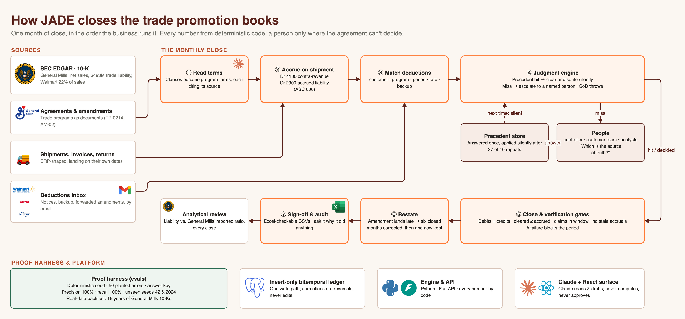

# JADE: pitch

Cal Hacks 13.0 · Hyphenate track · demo video on Devpost

## Tagline

**The trade promotion accountant that reopens its own books.**

## The problem

General Mills carries **$493M** of trade promotion promises on its balance sheet (accrued trade and coupon
promotion liabilities, FY2026 10-K). Every case it ships to Walmart, Costco and Kroger comes with a promised
discount. Months later the retailer collects by short-paying an invoice: at a different rate, citing a program
from two quarters ago, with backup that doesn't tie. People reconcile it by hand, and the mistakes hide in
months that are already closed.

## Why General Mills

- Walmart alone is **22%** of net sales ($18.4B, FY2026).
- The filings are public, so the simulated books are calibrated to real numbers: the liability ratio is
  checked against the 10-K at every close.
- Transaction-level trade data is never public, on either side of the trade. We say so, and seed it.

## The idea

JADE fills two seats: the **trade promotion accountant** and the **deduction analyst**. It runs the monthly
close the way the business does, and asks a person only when the agreement can't decide. Hyphenate's own rule,
enacted: **if it can't be verified, escalate.**

## The flow (what the demo shows, in order)

| Step | Finance work | On screen |
|---|---|---|
| 1 · Onboard | Read agreements into terms; mine controls from last year's decisions | Controls Library: threshold, owner, the precedents that taught each rule |
| 2 · Accrue | On shipment: Dr 4100 contra-revenue, Cr 2300 liability (ASC 606) | Journal Entries, filtered to accruals |
| 3 · Match | A deduction arrives; match by customer, program, period, rate, backup | Live Scenario: Walmart claims $4.50/case, the agreement says $3.80 |
| 3 · Control | The sales lead who negotiated the deal tries to approve it | Segregation of duties throws, in code |
| 4 · Ask once | "Which is the source of truth?" goes to the customer team; the answer becomes precedent | Escalation Inbox |
| 5 · Close | Verification gates block the period; flux explains every movement | Verification Gates, Flux & Close Review |
| 6 · Restate | August: an amendment nobody entered; $1,391,636.52 across six closed months | Overview alert, Restatement Comparison, controller approves |
| 7 · Audit | Ask it why it did anything | Interrogation: rule, clause, shipments, what it knew then, the correction |

## Proof: evals and the harness

Finance is formally verifiable, so we prove it the way Hyphenate frames the problem: deterministic code for every
number, and a harness that scores the agent against ground truth.

- **Harness:** deterministic generator (seed 1337), **50 planted errors** with an answer key, including in-tolerance variances
  that must pass silently, scored by `tpa/evaluate.py`.
- **Verification gates block, they don't warn:** debits = credits, cleared ≤ accrued, claims inside the window,
  reversals mirror, no stale accruals.
- **148 backend tests**; the model never computes a number and never approves.

### Before and after (measured, month 12)

| | Last year's playbook (no judgment engine) | With JADE |
|---|---|---|
| Planted errors caught (recall) | 95.2% | **100%** |
| Precision | 100% | **100%** |
| Self-approvals blocked | 0 of 2 | **2 of 2** |
| Repeat cases settled without a person | n/a | **37 of 40** |
| Unseen seeds 42 / 2024 | n/a | **100% / 100%** precision and recall |

Reproduce: `uv run python scripts/step.py --reset --through month-12 --autopilot --metrics` (before) and
`--players` (after); `uv run python scripts/evaluate.py --as-of month-1 --as-of month-12`.

Escalation rate is 40% in month 1 and 50% in month 12. It stays level because new kinds of situations keep
arriving; repeats don't escalate. Hyphenate's framing: 50% automation of a hard workflow is still 50% ROI.

## How it works

Sources (SEC EDGAR 10-K, agreements, shipments, retailer deductions) feed the seven-step close. Postgres holds an
insert-only bitemporal ledger; Python and FastAPI compute every number; Claude reads contracts and drafts
questions and explanations; React is the surface. Edit `images/jade-architecture.drawio` in draw.io.

## Q&A, under 20 seconds each

- **What's real?** The company, customers and liability sizes (10-K). Transactions are seeded; everything JADE
  does with them is real.
- **Show me something it got wrong.** On seed 42 it flagged a valid Kroger display claim by splitting an event
  across months. Fixed, with a test. Every miss is in `docs/proof.md`.
- **Why not 100% autonomy?** New kinds of situations should reach a person; 37 of 40 repeats didn't.
- **Could the AI approve its own work?** No: the agent has no approval rights, and the check throws.
- **What if the controller says no?** That answer becomes the rule (`make says-no`).
