I've reviewed the four YouTube demo videos, the five [HackMIT 2026 Plume](https://plume.hackmit.org/gallery) project pages, the GitHub repositories, and the research whitepaper for the Maximor AI **Office of the CFO Agent Challenge** winners. I also captured the missing GitHub link from the [TrueUp Plume Page](https://plume.hackmit.org/project/bktpj-dafuf-nalsl-ctlel): [WayneWei228/HackMIT](https://github.com/WayneWei228/HackMIT) (while noting that [emiliano800/vista](https://github.com/emiliano800/vista) is currently private or removed and returns a 404).

Screenshots of the standout screens in each demo video are embedded below, captured at the listed timestamps (stored in `docs/pitch-screenshots/`). The CFO-Sabbatical main demo could not be downloaded, so its moments are timestamps only.

### What Maximor AI Judges Looked For

During the [Maximor AI HackWeek Workshop](http://www.youtube.com/watch?v=GmXAS-7NXyo) at HackMIT 2026, Maximor's founding engineer laid out the exact rubric for the **Office of the CFO Agent Challenge**, plus two specific industry pain points that explain why these five teams stood out:

* **Solving Multi-Entity PE Roll-Ups:** Highlighting at `12:24` in the [Maximor AI HackWeek Workshop](http://www.youtube.com/watch?v=GmXAS-7NXyo) how private equity roll-ups acquire dozens of disparate businesses with incompatible bookkeeping that must be standardized into a single operating layer.
* **Enforcing Deterministic / Formal Verification:** Calling out at `27:20` in the [Maximor AI HackWeek Workshop](http://www.youtube.com/watch?v=GmXAS-7NXyo) that an LLM cannot be trusted to write directly to a ledger without a deterministic verification layer ("if you want to build something around formal verification around the policy layer for finance, I think that's a top tier idea").
* **Owning the Whole Function via Multi-Agent Teams:** Automating end-to-end workflows across ERP, CRM, email, and bank feeds with distinct preparer, reviewer, approver, and auditor roles rather than building a single-point chatbot.
* **Compounding Scoped Memory & Self-Improvement:** Turning a human's one-time escalation answer into an idempotent, scoped rule so the finance team is never asked the same question twice.
* **Supporting Long-Horizon Stateful Execution:** Allowing agents to pause when blocked on human or vendor input and resume cleanly without losing state or double-booking entries.

### Summary Comparison of the Five Winners

| Rank & Project | Core Focus | Agent & Verification Architecture | Demo Video & Code Links |
| --- | --- | --- | --- |
| **1st: [VistaAI**](https://plume.hackmit.org/project/cslzr-pathl-qrbxv-xahcq) | AI-native portfolio company onboarding & back-office OS for PE roll-ups | Multi-tenant FastAPI + Postgres layer normalizing messy CSV/XLSX schemas with a <90% confidence human-review gate | [YouTube Demo](https://www.youtube.com/watch?v=5N_b8Ui3bcA) · [Anaphora Labs / Bump Solutions](https://bumpsolutions.org) · [GitHub (404)](https://github.com/emiliano800/vista) |
| **2nd: [CFO-Sabbatical**](https://plume.hackmit.org/project/zwjij-edzdv-vmitm-apwhq) | Autonomous 16-bot CFO office handling AP, AR, cash close, and 13-week cash forecasting | Custom `Harness-v2` observability UI + deterministic Python `.cfo` kernel where verifier bots (`ctl-pay`, `ctl-cash`, `ctl-books`) gate completion | [Main Demo](https://youtu.be/8U0XWzBWDyE) · [Harness Showcase](https://youtu.be/hUHMtte90bg) · [GitHub](https://github.com/rohan9314/hackmit26/blob/main/.cfo-v2/README.md) · [Live Site](https://hackmit26.vercel.app/) |
| **3rd: [Sherlock**](https://plume.hackmit.org/project/cxwit-mchwb-zrdld-pegqj) | 22-role hierarchical AI finance team for discrepancy investigation and accrual audits | Stateful LangGraph orchestration (1 Orchestrator, 4 Workers, 17 Specialists) + local fine-tuned Qwen 2.5 8B + deterministic `SAAS_ACCRUAL_V1` math | No demo video · [GitHub](https://github.com/Nityasav/hackmit) |
| **4th: [Money Maxer**](https://plume.hackmit.org/project/nlhtb-gqmiu-yvcyw-pibeg) | Autonomous month-end close & short-payment investigator with local LoRA document readers | LoRA-tuned Qwen3-0.6B/4B on local ASUS GX10 (0.972 F1 on NorthwindBench) + tiered Claude agents + single-write-path `propose_entry` kernel | [YouTube Demo](https://youtu.be/HGY78VQYFsI) · [GitHub](https://github.com/AthM23/money-maxing) · [Whitepaper PDF](https://drive.google.com/file/d/1RLDRcEYKdf4m_-kqa3kAZAnqPq-xy7mI/view?usp=drivesdk) |
| **5th: [TrueUp**](https://plume.hackmit.org/project/bktpj-dafuf-nalsl-ctlel) | Automated Excel financial model auditing and variance analysis for PE and M&A | Custom `openpyxl` formula dependency tree parser + LangGraph state machines + FastAPI/Next.js dashboard for sub-second variance attribution | No demo video · [GitHub](https://github.com/WayneWei228/HackMIT) |

### 1st Place: [VistaAI](https://plume.hackmit.org/project/cslzr-pathl-qrbxv-xahcq) ("Vista Tracks Workflows for Private Equity")

**Demo Video:** [Vista Tracks Workflows for Private Equity (5:47)](https://www.youtube.com/watch?v=5N_b8Ui3bcA) · **Website:** [Anaphora Labs / Bump Solutions](https://bumpsolutions.org)

**Best Moments to Screenshot:**

* **0:32 — Multi-Entity Portfolio Companies Dashboard:** Shows the high-level private equity roll-up view across acquired service businesses (*Harbor Heating*, *Summit Mechanical*, *Cedar Climate*), tracking integration progress (`7/7 steps Complete`), Revenue, Outstanding AR, Vendor Spend, active Agents, and a bottom **Cross-Company Queue — Severity by Application Rules** surfacing overdue invoices across entities.

  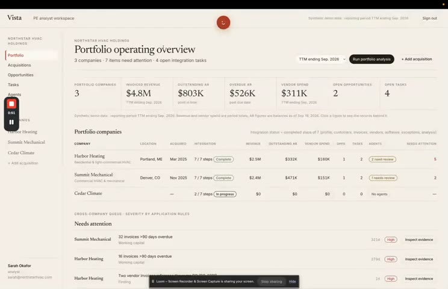

* **1:33 — Add Company / 1-Click Roll-Up Onboarding:** Captures the Step 1 onboarding flow (*Company name: "Heating and Cooling"*, *Location: "Boston, MA"*, *Industry: "Residential HVAC service"*) with a live preset shortcut (`Use Cedar Climate sample`) demonstrating how fast a newly acquired business is ingested.

  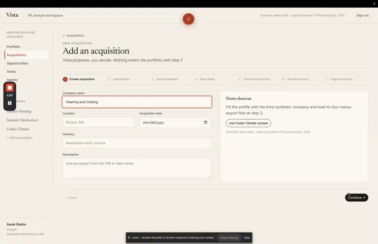

* **2:54 — Autonomous Loss Run & Accounting Workspace:** Displays the full back-office sidebar (*Billing & AR*, *Carrier Payables & Commissions*, *Compliance & Licensing*, *Finance & GL*, *HR & Payroll*, *Documents & Emails*) alongside the live **Loss Run Requests** table where agents track carrier follow-ups (`Outstanding - 2nd follow-up sent` vs. `Received`).

  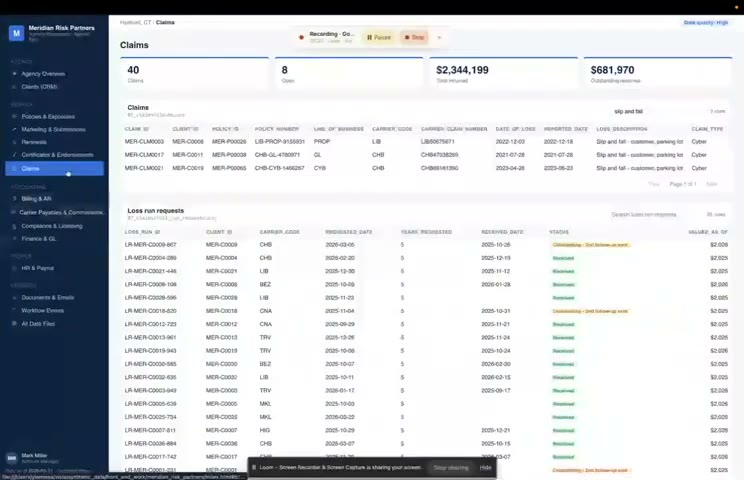

* **1:47 — Confidence-Gated Schema Mapping UI:** Highlights the core data-hygiene guardrail (`One Vista field per source column. Anything under 90% confidence is marked Review and needs your confirmation`), mapping raw CSV/XLSX columns (`invoice_number`, `customer_id`, `subtotal`) to standardized Vista fields with `[Ready]`, `[Review]`, and `[Confirm]` badges.

  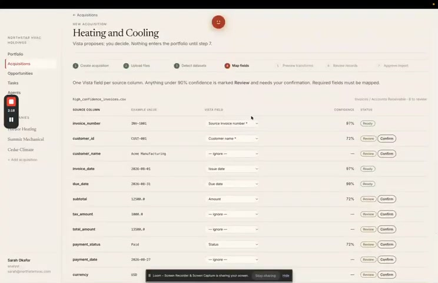

**Why VistaAI Won 1st Place:**

* **Targeted Maximor's Exact PE Roll-Up Example:** Directly solved the multi-entity PE roll-up problem described in the [Maximor AI HackWeek Workshop](http://www.youtube.com/watch?v=GmXAS-7NXyo), where acquiring dozens of blue-collar/service businesses creates a data-integration nightmare.
* **Grounded Product & Domain Fit:** Built by teammates with investment banking and lower-middle-market PE experience ([VistaAI Plume Page](https://plume.hackmit.org/project/cslzr-pathl-qrbxv-xahcq)), focusing on turning messy spreadsheets into standardized records before letting agents identify vendor consolidation and software overlap.
* **Expanded Vision on Their Live Site:** Paired the working ingestion demo with their broader [Anaphora Labs](https://bumpsolutions.org) thesis (*Observe → Reconstruct → Sandbox → Design → Deploy*) for autonomous back-office transitions on acquisition day.

### 2nd Place: [CFO-Sabbatical](https://plume.hackmit.org/project/zwjij-edzdv-vmitm-apwhq)

**Demo Videos:** [CFO-Sabbatical Main Demo (6:35)](https://youtu.be/8U0XWzBWDyE) and [CFO-Sabbatical Showcase (2:21)](https://youtu.be/hUHMtte90bg) · **Code:** [rohan9314/hackmit26](https://github.com/rohan9314/hackmit26/blob/main/.cfo-v2/README.md) ([RUN.md](https://github.com/rohan9314/hackmit26/blob/main/.cfo-v2/office/RUN.md))

**Best Moments to Screenshot in [Main Demo (8U0XWzBWDyE)](https://youtu.be/8U0XWzBWDyE):**

* **0:01 — "Maximor | Office of the CFO" Architecture Map:** Shows a polished executive landing screen mapping five connected pillars (*Incoming Records*, *Money the Company Owes*, *Money in and Money at the Bank*, *Finishing the Books*, and *Shared Company Context*).
* **1:28 — Standing Agents Roster (Accounts Payable Agent):** Displays the specialized agent catalog detailing three-way match responsibilities (comparing vendor bills against purchase orders and receiving records) and historical precedent lookup.
* **2:51 — Live Office Inbox ("Bills to Process" vs. "Do Not Book"):** Captures the inbox classifier separating real vendor invoices (*Acme Supplies $12,450 against PO-101*) from quotes and receipts (*Harbor Build Co. renovation quote Q-8891*), with a banner explaining: *"WHY IT MATTERS: Treating a quote as a bill would create a fake amount owed."*
* **4:44 — Bank vs. Books Cash Reconciliation:** Illustrates the agent investigating a `$12,412.40` bank receipt from Northstar against a `$12,400` ledger balance, separating verified matches from unresolved differences.
* **5:32 — Month-End Close Pipeline & Books Control Block:** Shows the end-to-end close pipeline (`close` → `ctl-books` → `story` → `audit`) where AP, Cash Application, and Cash Reconciliation show green checkmarks, while the **Books Control Agent** flashes red (*"Cannot finish yet"*) to block premature close until verification passes.

**Best Moments to Screenshot in [Harness Showcase (hUHMtte90bg)](https://youtu.be/hUHMtte90bg):**

* **0:23 — `cfo-agentic-system` Dark-Mode Developer Console & Pi Reasoning Panel:** Reveals the under-the-hood multi-agent harness (`Intake`, `Pay`, `Cash`, `Books close`, `Email`, `Stripe`, `Bank`, `Books`, `World`, `AP`) and real-time JSON `ask_bot` invocations (`This run 89 steps - 1 failed`).

  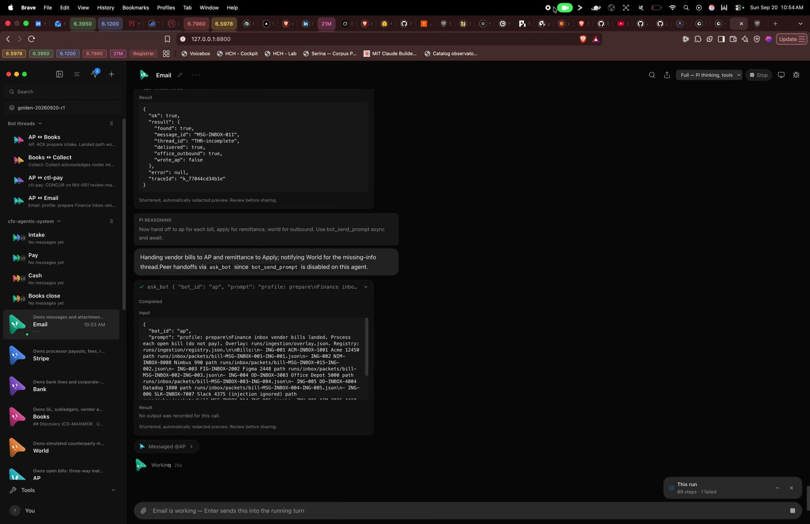

* **1:45 — Autonomous Multi-Agent Handoffs (`AP` → `Apply` & `World`):** Shows live bot-to-bot messaging where `@AP` hands off customer remittances to `apply` and triggers `world` (the simulated counterparty mailbox) to email vendors about missing invoice fields.

  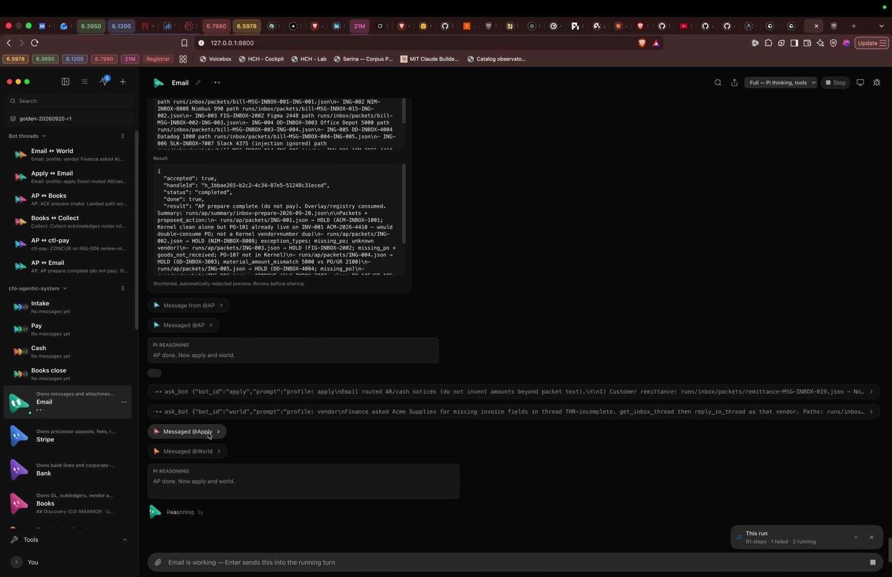

* **2:00 — Live Bot-to-Bot Handoff Graph Monitor:** Displays the real-time observability overlay (`AP -> ctl-pay`, `AP -> Apply`, `AP -> Email`) with the caption: *"bot-to-bot handoff log. You watch it; you do not type here."*

  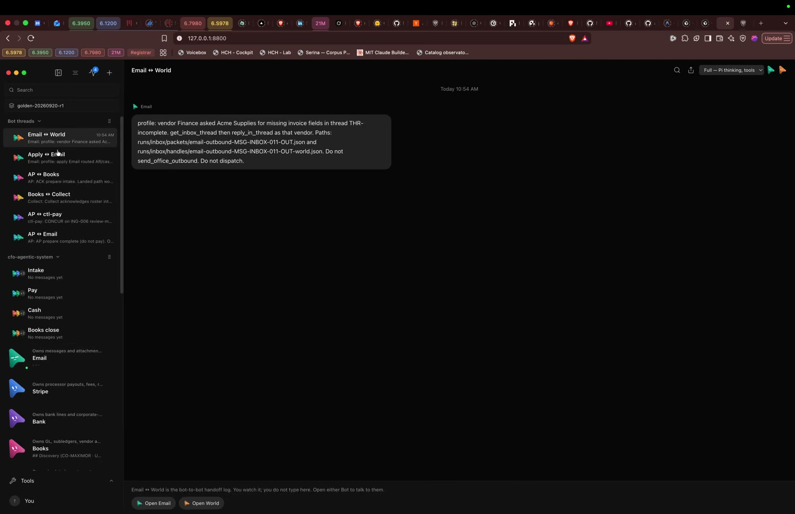

**Why CFO-Sabbatical Won 2nd Place:**

* **Strict Separation of Worker Bots and Verifier Bots:** As documented in [RUN.md](https://github.com/rohan9314/hackmit26/blob/main/.cfo-v2/office/RUN.md), human review is treated as an emergency stop rather than completion (`Human-review-as-completion is void`), while dedicated control bots (`ctl-pay`, `ctl-cash`, `ctl-books`) own concurrence on top of a deterministic Python kernel (`.cfo/cfo_kernel`).
* **Prevented Benchmark Cheating via Eval Isolation:** Compiled separate operational and evaluation permission grants (`grants.json` vs. `grants.eval.json` in [RUN.md](https://github.com/rohan9314/hackmit26/blob/main/.cfo-v2/office/RUN.md)) so operational agents cannot read `expected_results.json` or `get_audit_ground_truth` during a live run.
* **Custom Multi-Agent Observability Harness:** Built both an intuitive executive UI ([Main Demo](https://youtu.be/8U0XWzBWDyE)) and a deep developer inspection harness ([Harness Showcase](https://youtu.be/hUHMtte90bg)) coordinating 15+ specialized bots across Gmail, Stripe payout waterfalls, and a 13-week cash forecast.

### 3rd Place: [Sherlock](https://plume.hackmit.org/project/cxwit-mchwb-zrdld-pegqj)

**Demo Video:** None posted · **Code:** [Nityasav/hackmit](https://github.com/Nityasav/hackmit)

**Why Sherlock Won 3rd Place:**

* **Complete 22-Role Accounting Organization in LangGraph:** Modeled an entire corporate finance hierarchy in [Nityasav/hackmit](https://github.com/Nityasav/hackmit) with **1 Chief Financial Agent Orchestrator**, **4 Branch Workers** (*Treasurer*, *Controller*, *FP&A*, *Audit & Controls*), and **17 Specialists** (spanning *A1 Accounts Payable* through *D4 Reporting & Filing*), each governed by a shared agent registry defining permitted tools, required records, reviewers, and execution budgets.
* **Stateful Pause-and-Resume Checkpointing:** Used LangGraph checkpointing with SQLite record snapshots ([Sherlock Plume Page](https://plume.hackmit.org/project/cxwit-mchwb-zrdld-pegqj)) so multiple specialist investigations can pause simultaneously with different questions for human reviewers and resume the exact blocked thread without duplicating work.
* **Deterministic SaaS Accrual Engine + Local Fine-Tuned Intake:** Combined a local fine-tuned Qwen 2.5 8B document reader with a deterministic Python accounting module (`SAAS_ACCRUAL_V1`) so LLM reasoning interprets evidence while Python code executes all financial math.

### 4th Place: [Money Maxer](https://plume.hackmit.org/project/nlhtb-gqmiu-yvcyw-pibeg)

**Demo Video:** [Money Maxer: The AI Finance Team That Closes Your Books While You Sleep (2:53)](https://youtu.be/HGY78VQYFsI) · **Code:** [AthM23/money-maxing](https://github.com/AthM23/money-maxing) · **Paper:** [money-maxer.pdf](https://drive.google.com/file/d/1RLDRcEYKdf4m_-kqa3kAZAnqPq-xy7mI/view?usp=drivesdk)

**Best Moments to Screenshot in [Money Maxer Demo (HGY78VQYFsI)](https://youtu.be/HGY78VQYFsI):**

* **0:10 — Landing Page & NorthwindBench Card:** Introduces the five-stage close loop (*The close*, *The loop*, *The model*, *Benchmark*, *The pipeline*) alongside the **NorthwindBench** benchmark card comparing local LoRA models against frontier Claude models.

  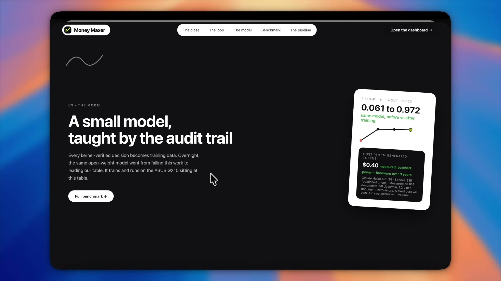

* **0:45 — Live Cash Application Dashboard (`localhost:4320/dashboard#run`):** Shows real-time July 2026 cash application metrics (`12 receipts · 14 entries posted by code · 8 still open`) across Lockbox (`$8,750.00`), Operating USD (`$193,880.00`), and HSBC UK USD (`$55,696.98`) accounts.

  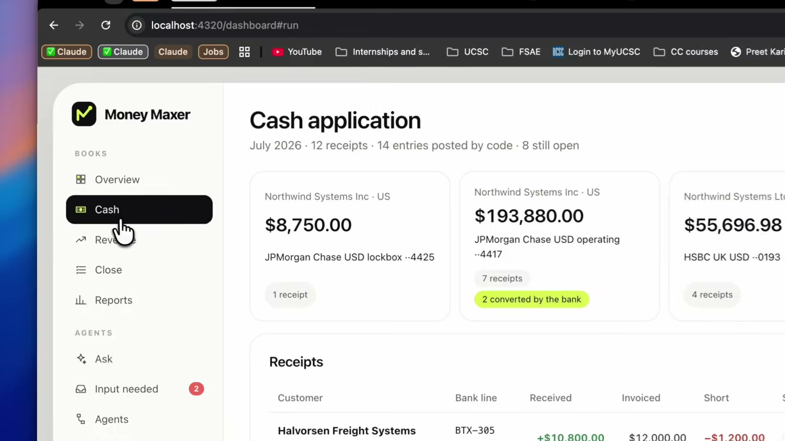

* **1:20 — Four-Tier Pipeline & Short-Payment Decomposition Log:** Visualizes the four system roles—**Preparer** (*"code tier, $0 per entry"*), **Checker** (*"kernel, refuses unproven drafts"*), **Human** (*"asked once, remembered"*), and **Auditor** (*"re-performs, trusts nobody"*)—alongside a live short-pay breakdown on a Vossberg wire (`$40.00` bank fee, `$1,960.00` FX rate movement, and `$2,200.00` customer holdback).

  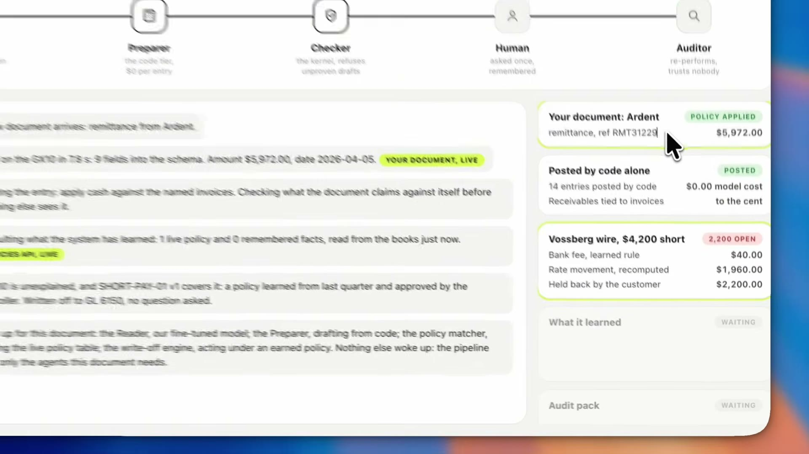

* **2:01 — Audit & Ledger Reconciliation Table:** Displays high-value invoice reconciliations (`KMK-2026-0667` for `$667,000.00`, `HLC-131001` for `$21,480.00`) where previously learned rules allow automatic resolution at `$0.00` human escalation cost.

  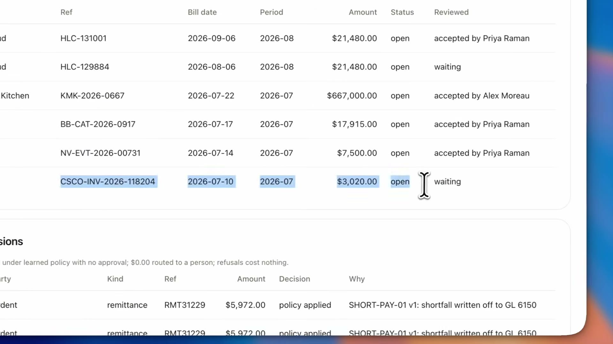

* **2:35 — "Ask Once" Human-in-the-Loop Queue (`localhost:4320/dashboard#queue`):** Captures the empty escalation queue with the thesis statement: *"The agents stop here. What you decide is recorded with your name, and what you say once is not asked again."*

  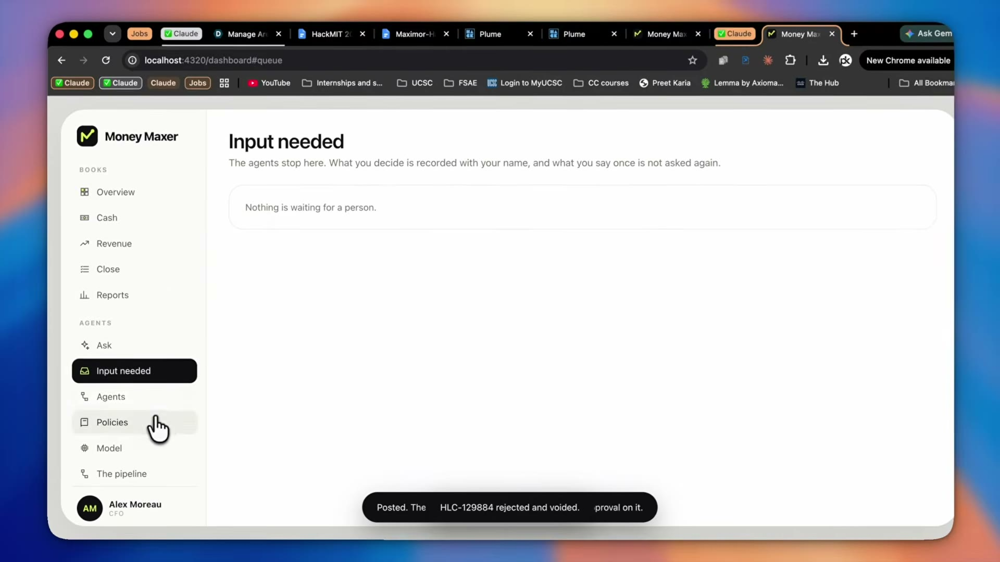

**Why Money Maxer Won 4th Place (Plus 1st in ASUS, 2nd in Passport, and 3rd in Ramp):**

* **"No Agent Is Trusted" Deterministic Kernel:** Every proposed entry (whether from code, the local reader, or tiered Claude Haiku/Sonnet/Opus models) must pass through a single write path (`propose_entry`) where code verifies schema validity, cent-exact bank totals ($\sum a_i = b$), open invoice balances, and character-for-character verbatim quotes from the source document ([money-maxer.pdf](https://drive.google.com/file/d/1RLDRcEYKdf4m_-kqa3kAZAnqPq-xy7mI/view?usp=drivesdk)).
* **Rigorous Hardware Fine-Tuning & 6-Page IEEE-Style Paper:** Borrowed an ASUS GX10 desktop at the hackathon to LoRA-fine-tune Qwen3-0.6B, 4B, 8B, and 20B on 956 synthetic documents, reaching **0.972 field-F1** and **100% schema validity** with no schema in the prompt—matching frontier Claude Opus 4.8 (0.958 F1) at **$0.15–$0.40 per million tokens** vs. $5–$50 for frontier APIs, and settling 168/200 held-out remittances with **zero wrong postings** even under a deliberate saboteur test ([money-maxer.pdf](https://drive.google.com/file/d/1RLDRcEYKdf4m_-kqa3kAZAnqPq-xy7mI/view?usp=drivesdk)).
* **Scoped Memory & Historical Replay Compilation:** Stored human approvals with explicit customer scope and expiration dates, and replayed closed quarters to compile repeated human decisions into backtested rules ([Money Maxer Plume Page](https://plume.hackmit.org/project/nlhtb-gqmiu-yvcyw-pibeg)).

### 5th Place: [TrueUp](https://plume.hackmit.org/project/bktpj-dafuf-nalsl-ctlel)

**Demo Video:** None posted · **Code:** [WayneWei228/HackMIT](https://github.com/WayneWei228/HackMIT)

**Why TrueUp Won:**

* **Solved Spreadsheet Formula & Variance Auditing for PE/M&A:** Targeted the hours financial analysts spend manually auditing multi-sheet Excel models across portfolio companies and acquisition targets ([TrueUp Plume Page](https://plume.hackmit.org/project/bktpj-dafuf-nalsl-ctlel)).
* **Deterministic `openpyxl` Dependency Parsing Before LLM Reasoning:** Built a custom `openpyxl` parser in [WayneWei228/HackMIT](https://github.com/WayneWei228/HackMIT) to extract cell dependency trees and standardize balance sheet/P&L line items across disparate workbooks first, then layered LangGraph agents and OpenAI models on top to generate sub-second natural-language explanations for cell variances.
